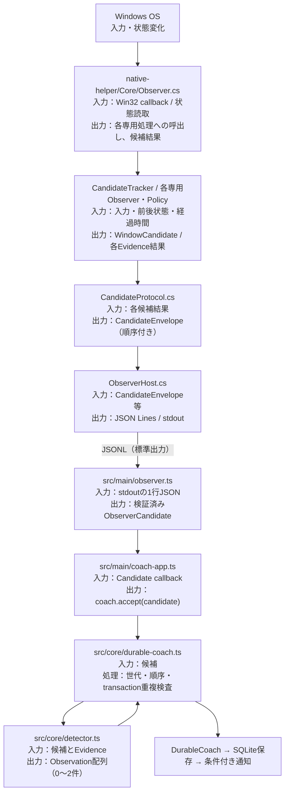
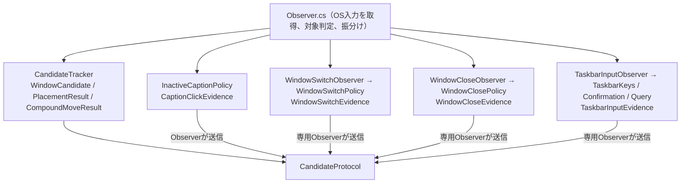

# 01 現行処理フロー（2026-11-06時点）

調査基準：[main@29bd044](https://github.com/YutoMatsui21/shortcut-expert/tree/29bd044be4dc7d71e38179d556d6a272787fe949)。**現在の呼び出しと通信の記述**であり、将来の理想図ではない。コンポーネント詳細は [02 責務一覧](02-responsibilities.md)、依存関係は [03 依存関係](03-dependencies.md)。

## 1. 全体の入出力

`native-helper` はWin32の入力・状態を観測し、同じ操作に関連する証拠を持つ **Candidate（操作候補）** を出力する。生のマウス・キーイベントをTypeScriptへ逐一転送する構造ではない。`src` はCandidateを検証して **Observation（採用された製品上の操作）** に変換する。

※図の「Tracker / 各専用Observer」は複数の経路をまとめたもの。**全CandidateがCandidateTrackerを通るわけではない**（後述）。また`detector.ts`は`DurableCoach.accept()`から呼ばれ、観測結果を返す。

参照：[Observer.cs](https://github.com/YutoMatsui21/shortcut-expert/blob/29bd044be4dc7d71e38179d556d6a272787fe949/native-helper/Core/Observer.cs#L38-L65)、[CandidateProtocol.cs](https://github.com/YutoMatsui21/shortcut-expert/blob/29bd044be4dc7d71e38179d556d6a272787fe949/native-helper/Core/CandidateProtocol.cs#L168-L190)、[ObserverHost.cs](https://github.com/YutoMatsui21/shortcut-expert/blob/29bd044be4dc7d71e38179d556d6a272787fe949/native-helper/Core/ObserverHost.cs#L4-L12)、[observer.ts](https://github.com/YutoMatsui21/shortcut-expert/blob/29bd044be4dc7d71e38179d556d6a272787fe949/src/main/observer.ts#L655-L685)、[durable-coach.ts](https://github.com/YutoMatsui21/shortcut-expert/blob/29bd044be4dc7d71e38179d556d6a272787fe949/src/core/durable-coach.ts#L446-L485)。

## 2. Observerが受け取るもの

| 入口 | 登録されるAPI / イベント | Observer内の入口 | 次の処理に渡す情報 |
| --- | --- | --- | --- |
| マウス | `SetWindowsHookExW(WH_MOUSE_LL)` | `OnMouse` | 押下・解放・移動、座標、注入フラグ、クリック対象、前状態等 |
| キーボード | `SetWindowsHookExW(WH_KEYBOARD_LL)` | `OnKey` | 仮想キー、押下/解放、修飾キー状態、注入フラグ、前状態等 |
| ウィンドウ | `SetWinEventHook` ×5範囲 | `OnEvent` | foreground変更、位置変更、移動・サイズ変更開始/終了、生成/破棄/非表示、最小化開始/終了等。必要時に現在の窓状態を再取得 |
| 補助 | 50ms WinForms Timer、表示・設定の変更通知 | `PollMaximize` 等 / `ObserverHost` から呼出し | 非同期に確定する最大化・非アクティブ窓クリックの照合、表示環境キャッシュの無効化 |

`OnEvent`に「最大化した」という専用イベントが来るのではなく、WinEventを契機に`GetWindowPlacement`、DWM情報、Monitor等を読み、前後状態を比較する。登録範囲`EVENT_OBJECT_CREATE..EVENT_OBJECT_HIDE`には`EVENT_OBJECT_DESTROY`も含まれる。

参照：[Observer.Start()](https://github.com/YutoMatsui21/shortcut-expert/blob/29bd044be4dc7d71e38179d556d6a272787fe949/native-helper/Core/Observer.cs#L98-L145)、[Observer.Read()](https://github.com/YutoMatsui21/shortcut-expert/blob/29bd044be4dc7d71e38179d556d6a272787fe949/native-helper/Core/Observer.cs#L180-L255)、[Observer.OnEvent()](https://github.com/YutoMatsui21/shortcut-expert/blob/29bd044be4dc7d71e38179d556d6a272787fe949/native-helper/Core/Observer.cs#L760-L876)。

## 3. C#内には異なる候補生成経路がある

- `CandidateTracker` は入力・ウィンドウ状態・時間を関連付け、返り値を `Observer` が種類に応じて `protocol.Complete/Placement/Compound` へ渡す。
- `WindowSwitchObserver`、`WindowCloseObserver`、`TaskbarInputObserver` は、内部のPolicy等で判定後、**CandidateProtocolを直接呼ぶ**。
- `InactiveCaptionPolicy` の結果は `Observer` のタイマー処理が `protocol.CaptionClick` に渡す。
- `SnapInvocationObserver` と `protocol.Invocation` はコードに存在するが、基準コミットの `Observer` からは生成・開始されていない。初回公開対象の有効な検出経路と扱わない。

参照：[Observerの保持先](https://github.com/YutoMatsui21/shortcut-expert/blob/29bd044be4dc7d71e38179d556d6a272787fe949/native-helper/Core/Observer.cs#L9-L65)、[OnEventの候補出力](https://github.com/YutoMatsui21/shortcut-expert/blob/29bd044be4dc7d71e38179d556d6a272787fe949/native-helper/Core/Observer.cs#L810-L869)、[WindowSwitchObserver](https://github.com/YutoMatsui21/shortcut-expert/blob/29bd044be4dc7d71e38179d556d6a272787fe949/native-helper/Window/WindowSwitchObserver.cs#L259-L288)、[WindowCloseObserver](https://github.com/YutoMatsui21/shortcut-expert/blob/29bd044be4dc7d71e38179d556d6a272787fe949/native-helper/Window/WindowCloseObserver.cs#L250-L263)、[TaskbarInputObserver](https://github.com/YutoMatsui21/shortcut-expert/blob/29bd044be4dc7d71e38179d556d6a272787fe949/native-helper/Taskbar/TaskbarInputObserver.cs#L143-L172)。

## 4. C# → TypeScript間の実際の契約

`CandidateProtocol` は候補種別を `CandidateEnvelope` に包む。主なフィールドは `type`, `protocolVersion`, `generation`, `sequence`, `transaction`, `date`, `origin`, `route`, `injected`, `conflicted`, `evidence`。`evidence` は `window`、`window-switch`、`placement`、`compound-drag`、`caption-click`、`window-close`、`taskbar-input` 等の種別を持つ。古い窓状態候補は `evidence.kind="window"` の `result.operation="maximize"` 等を含む。

- `CandidateProtocol`：送信順序の`sequence`を付与し、`generation`を確認。操作の発生源に応じた`route`と証拠を組み立てる。
- `ObserverHost.Emit`：`JsonSerializer.Serialize` → `Console.WriteLine`。標準出力で1行ずつ送る（ディスク上のJSONLファイルではない）。
- `ObserverClient`：child processのstdoutを行ごとにバッファし`JSON.parse`、`candidateV2`で必須項目と`evidence.kind`を厳格検証してからコールバックへ渡す。
- `coach-app.ts`：`coach.accept(candidate)` を呼び出す。
- `DurableCoach.accept`：観測中か、世代一致、sequence順、transaction未処理かを確認してから`classifyGesture`を呼ぶ。
- `detector.ts`：`Observation[]`を返す。証拠に応じW IDとショートカットを割り当てる。1候補から0件・1件・最大2件（複合操作）。
- `DurableCoach`：結果を保存し、学習中・マウス由来・ショートカット案内可などを判定して通知を依頼。

参照：[C# CandidateEnvelope](https://github.com/YutoMatsui21/shortcut-expert/blob/29bd044be4dc7d71e38179d556d6a272787fe949/native-helper/Core/CandidateProtocol.cs#L120-L132)、[TypeScript型](https://github.com/YutoMatsui21/shortcut-expert/blob/29bd044be4dc7d71e38179d556d6a272787fe949/src/shared/coach.ts#L16-L132)、[受信](https://github.com/YutoMatsui21/shortcut-expert/blob/29bd044be4dc7d71e38179d556d6a272787fe949/src/main/observer.ts#L517-L535)、[採用](https://github.com/YutoMatsui21/shortcut-expert/blob/29bd044be4dc7d71e38179d556d6a272787fe949/src/core/detector.ts#L11-L113)。

## 5. 代表的な操作の追跡

| ユーザー操作 | C#側の主な照合 | protocol経路 | TS側の製品判定 |
| --- | --- | --- | --- |
| アクティブ窓の最大化クリック | `OnMouse` が対象・ボタン等を調べ、`CandidateTracker`が前後状態と入力を照合 | `protocol.Complete` → `window` Evidence | `classifyWindow`が条件確認後 W03 / Win + ↑ |
| アクティブ窓の直接クリック切替 | `WindowSwitchObserver/Policy` がクリック先とforeground確定を照合 | `protocol.Switch` → `window-switch` Evidence | W01 / Alt + Tab |
| 非アクティブ窓の最大化・最小化クリック | `InactiveCaptionPolicy` がforeground変化と窓の終状態を照合 | `protocol.CaptionClick` → `caption-click` Evidence | 1候補からW01とW03/W04をそれぞれ採用できる |
| モニター間の複合ドラッグ | `CandidateTracker.FinishMove` が移動元・移動先と終状態を照合 | `protocol.Compound` → `compound-drag` Evidence | W02とW03/W07を同じgestureとして採用できる |
| タスクバークリック／Win+数字 | `TaskbarInputObserver` がタスクバーのslotと再確認snapshotを照合 | `protocol.Taskbar` → `taskbar-input` Evidence | W12 / Win + 数字 |

この表は**内部経路の例**。実機検出率や全環境での成立を保証するものではない。各成立・除外条件は[操作別設計](../../operations/README.md)を確認する。

## 6. 今回の調査範囲と非対象

- 調査対象はソースの構造と呼び出しの静的確認。実Windows入力、CI、配布物の実機検証はしていない。
- 本文は**現状の記述のみ**。理想のDispatcher/Evidence Builderや新インターフェースはまだ採用していない。
- 追加機能時に修正が必要な箇所と、仕様上必須の変更箇所の区別は次の設計ステップで確定する。
