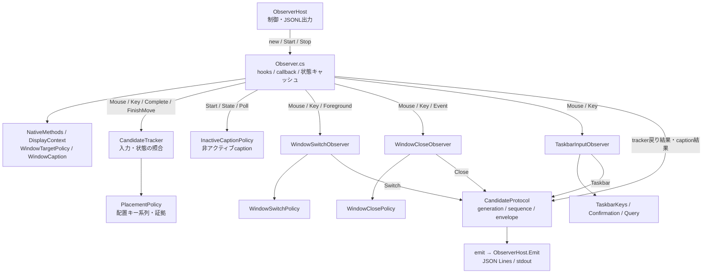

# 03 現行の依存関係・状態所有・変更波及

調査基準：[main@29bd044](https://github.com/YutoMatsui21/shortcut-expert/tree/29bd044be4dc7d71e38179d556d6a272787fe949)。**実装から確認できる依存関係**と、次の設計ステップで検討すべき**変更容易性の懸念**を分けて書く。新インターフェースや移動先は未決定。

## 1. Nativeの直接的な依存関係（主要経路）

矢印は「呼び出す・利用する」方向。戻り値をObserverが送る経路と、専用Observerが直接CandidateProtocolへ送る経路を区別する。

**図に含めなかった補助依存**：`Observer`や各専用ObserverはWin32/API・時計・診断callbackも直接呼ぶ。`TaskbarQuery`は非同期でスナップショットを取得する。`SnapInvocationObserver`と`SnapInvocationPolicy`の実装は存在するが、基準コミットの`Observer`で生成されていないため主経路には含めない。

## 2. Observerが具体的な実装を知っている箇所

| 呼び出し元 | 具体的な呼出し・前提 | 変更時の結合 |
| --- | --- | --- |
| `Observer.OnMouse` | `taskbar.Mouse`、`switching.Mouse`、`closing.Mouse`、`tracker.MouseMessage/Mouse/MouseReleased/MouseMoved`、`captionClick.Start/Mouse`などを条件付きで呼ぶ | 新しい検出器にマウス入力を渡す場合、Observerの呼出しや競合条件が追加される可能性 |
| `Observer.OnKey` | 各Observerの`Key`、`tracker.Key/KeyReleased/FinishKey`等を順序付きで呼ぶ | ある入力を専用Observerへ渡す際、既存のキー判定・取消と干渉しうる |
| `Observer.OnEvent` | `closing.Event`、`switching.Foreground`、`tracker.ForegroundChanged/MoveStart/FinishMove/Complete`、`captionClick.State/Foreground`を分岐で呼ぶ | 窓イベントの追加・取消・候補確定がObserverの同一メソッドへ集中 |
| `Observer`の結果送信 | `WindowCandidate`/`PlacementResult`/`CompoundMoveResult`という**具体的な戻り型**を見て`protocol.Complete/Placement/Compound`を選ぶ | 候補結果の種別追加がObserverの分岐修正につながりうる |
| 専用Observerの生成 | コンストラクタで`WindowSwitchObserver`、`WindowCloseObserver`、`TaskbarInputObserver`を直接生成し、`protocol`と`tracker.NextTransaction`を渡す | ライフサイクルと共通transactionの責務がObserver/Trackerに接続される |

参照：[Observerコンストラクタ](https://github.com/YutoMatsui21/shortcut-expert/blob/29bd044be4dc7d71e38179d556d6a272787fe949/native-helper/Core/Observer.cs#L38-L65)、[OnMouse](https://github.com/YutoMatsui21/shortcut-expert/blob/29bd044be4dc7d71e38179d556d6a272787fe949/native-helper/Core/Observer.cs#L293-L589)、[OnKey](https://github.com/YutoMatsui21/shortcut-expert/blob/29bd044be4dc7d71e38179d556d6a272787fe949/native-helper/Core/Observer.cs#L593-L688)、[OnEvent](https://github.com/YutoMatsui21/shortcut-expert/blob/29bd044be4dc7d71e38179d556d6a272787fe949/native-helper/Core/Observer.cs#L760-L876)。

## 3. 状態は誰が持っているか

| 状態・ライフサイクル | 所有者 | 関係する操作・影響 |
| --- | --- | --- |
| OS Hook、イベントcallback、観測epoch | `Observer` | すべての観測の開始・停止 |
| 前回の`WindowState`キャッシュ（HWND別） | `Observer.states` | 状態遷移判定の`before`/`after` |
| 最近の入力`input`、ドラッグ`drags/dragPress`、Win+↑候補`winUp`、連続Win+↓`completedWinDown` | `CandidateTracker` | 最大化・最小化・ドラッグ・モニター移動等 |
| Win+方向キーの継続シリーズ、押下キー、取消 | `CandidateTracker.Placement`（`PlacementPolicy`） | 左右半分・四隅の判定 |
| 非アクティブcaptionの対象・押下・解放・終状態・foreground切替 | `Observer.captionClick`（`InactiveCaptionPolicy`） | 切替＋最大化・最小化の複合操作 |
| 切替の前後対象・Alt+Tabキー系列・settle待ち | `WindowSwitchObserver/WindowSwitchPolicy` | W01 |
| 閉じる対象・Alt+F4系列・destroy確認待ち | `WindowCloseObserver/WindowClosePolicy` | W11 |
| タスクバーsnapshot・slot・確認待ち・非同期読取 | `TaskbarInputObserver/TaskbarKeys/TaskbarConfirmation` | W12 |
| Nativeのtransaction番号 | `CandidateTracker.NextTransaction()`、専用Observerへcallback提供 | 複数の候補生成経路で共有する識別子 |
| Nativeの送信`sequence`/`generation`と直列化lock | `CandidateProtocol` | 候補の送信順序と世代一致 |
| Mainのhelperプロセス・世代・JSON行buffer・コマンド応答 | `ObserverClient` | 受信境界・失敗時停止 |
| Coreの受理`generation/sequence`・処理済み`transaction`・SerialQueue | `DurableCoach` | 重複採用・再配送防止 |

特に、**操作の一時状態はCandidateTrackerだけではなく、各専用Observer・Policyへ分散している**。ただし、分散自体を即座に欠陥と決めない。各操作固有の状態であれば独立が適切な場合もある。

参照：[CandidateTracker状態](https://github.com/YutoMatsui21/shortcut-expert/blob/29bd044be4dc7d71e38179d556d6a272787fe949/native-helper/Core/CandidateTracker.cs#L38-L147)、[WindowSwitchPolicy](https://github.com/YutoMatsui21/shortcut-expert/blob/29bd044be4dc7d71e38179d556d6a272787fe949/native-helper/Window/WindowSwitchPolicy.cs)、[InactiveCaptionPolicy](https://github.com/YutoMatsui21/shortcut-expert/blob/29bd044be4dc7d71e38179d556d6a272787fe949/native-helper/Window/InactiveCaptionPolicy.cs)、[Core重複防止](https://github.com/YutoMatsui21/shortcut-expert/blob/29bd044be4dc7d71e38179d556d6a272787fe949/src/core/durable-coach.ts#L446-L484)。

## 4. 複数経路間の競合と送信境界

**確認できる例**：

1. キー入力では`Observer.OnKey`が`captionClick.Cancel()`、`tracker.CancelMouseState()`を行い、各専用Observerへ入力を渡す。
2. foreground変化では`tracker.ForegroundChanged`と`switching.Foreground`を呼ぶ。ウィンドウ移動開始時には`switching.Cancel()`し、`tracker.MoveStart`へ引き継ぐ。
3. 非アクティブcaptionクリックの待機中は、`Observer`が通常のマウス候補の処理を抑制・取り消す場合がある。
4. `CandidateTracker.Complete`は、進行中ドラッグや配置シリーズのtransactionがあると、派生する窓状態変化の候補を抑制する。
5. `CandidateProtocol`は候補の種類ごとに異なる入口を持つが、同じenvelopeと`sequence`で送信順を整理する。
6. TypeScriptの`DurableCoach`は**transactionを採用判定より前に消費**する。C#側が同じtransactionで別Candidateを順次送ると、後続が破棄される。このため、複合操作は1Envelopeで複数Observationへ展開する設計が用いられている。

これらは現行の誤検出・重複対策でもあり、単純に共通Dispatcherへ置き換えるだけでは保存できない振る舞い。依存の削減と競合の制御を別々に検討する必要がある。

参照：[OnKey](https://github.com/YutoMatsui21/shortcut-expert/blob/29bd044be4dc7d71e38179d556d6a272787fe949/native-helper/Core/Observer.cs#L593-L608)、[OnEvent](https://github.com/YutoMatsui21/shortcut-expert/blob/29bd044be4dc7d71e38179d556d6a272787fe949/native-helper/Core/Observer.cs#L783-L817)、[Tracker.Complete](https://github.com/YutoMatsui21/shortcut-expert/blob/29bd044be4dc7d71e38179d556d6a272787fe949/native-helper/Core/CandidateTracker.cs#L832-L964)、[Protocol](https://github.com/YutoMatsui21/shortcut-expert/blob/29bd044be4dc7d71e38179d556d6a272787fe949/native-helper/Core/CandidateProtocol.cs#L168-L445)、[DurableCoach](https://github.com/YutoMatsui21/shortcut-expert/blob/29bd044be4dc7d71e38179d556d6a272787fe949/src/core/durable-coach.ts#L446-L482)。

## 5. 機能追加時の変更波及（分析）

**以下は静的構造に基づく変更可能性であり、まだ実装・動作確認した事実ではない。**

| 追加するもの | 変更が波及しそうな場所 | 理由 |
| --- | --- | --- |
| 既存`window` Evidenceで表現できる新しい窓操作 | `CandidateTracker`の入力/状態照合、`detector.ts`の操作ID・案内判定、関連する試験・型 | Nativeの意味づけとTSの採用規則に別の分岐が存在する |
| 新しいWindows入力経路・イベントに反応する検出器 | `Observer`のhook/振分け/競合制御、専用Observer等 | Observerが各検出処理の具体メソッド・順序を知っている |
| 新しいEvidence種別 | `CandidateProtocol`、`src/shared/coach.ts`、`src/main/observer.ts`、`src/core/detector.ts`、関連テスト | C# serializerとTS parser・採用判定が同じwire契約に依存する。**通信境界の変更自体は正当な変更** |
| 新しい複合操作 | 候補間のtransaction管理、`CandidateProtocol`、`classifyGesture`、`DurableCoach` | 現状は同一gestureの複数Operationを1Candidateから返す。競合と最大2件保存の制約がある |
| テキスト操作の追加 | Windowsでの安全な観測方法、別種のEvidence、TS受信/判定 | 現行のWindowState・caption前提はそのまま流用できない。文字・生キー列を保存/送信しない制約がある |

## 6. Step 2で検討すべき問い（結論は出さない）

1. **イベント境界**：Observerは何を共通の観測イベントとして出し、どの情報取得（Win32読取・hit test）をどこに置くか。
2. **検出器の契約**：各操作の候補を共通interfaceで出せるか。特に戻り値型の違い（`WindowCandidate`/`PlacementResult`/`CompoundMoveResult`）と直接protocolを呼ぶ専用Observerをどう統一するか。
3. **状態所有**：専用Detectorの私有状態、複数Detector間の競合・取消、共通transactionの発行はそれぞれ誰が担うか。
4. **C# / TS境界**：Windowsの観測事実の確定と、記録対象・操作ID・案内の製品ルールをどう区別するか。Win+↓連続操作のように記録単位に関係するNative側の処理をどう扱うか。
5. **プロトコル移行**：既存`CandidateEnvelope`を維持するか。変更する場合、C#/TS双方とテスト・実機確認をどの段階で切り替えるか。
6. **比較方法**：既存操作の振る舞いが保持されることに加え、「新しい操作を1つ増やす際の既存ファイルの変更数・変更理由」をどう評価するか。

## 7. 制約・検証状況

- この文書は**ソースの静的解析に基づく**。自然入力、Windows APIのイベント順序、配布状態での検出率を実測していない。
- 問題候補は「現行の機能が誤動作している」という主張ではない。既存の分岐・状態の保持には保守的な検出精度・プライバシー確保の目的がある可能性を残す。
- リファクタリングの設計・採用・Issueの受入条件は、これらの観測事実を基にした**Step 2以降で確定する**。
