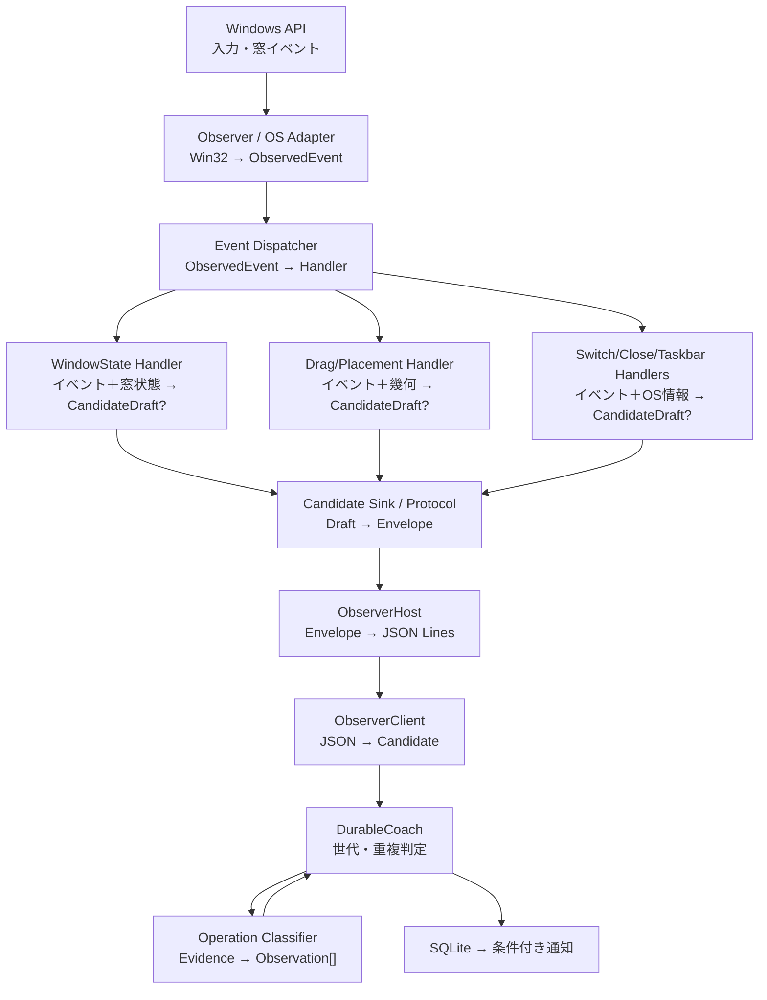

# 04 目標アーキテクチャ案（Step 2）

> **後続決定（2026-11-06）**：本書は当時の検討案。未確定だったDispatcher/Handler/調停API・状態所有・移行境界は[10 確定判断](10-architecture-decisions.md)・[11 配送と所有権](11-routing-and-ownership.md)・[12 移行ゲート](12-migration-and-gates.md)で具体化した。**新しい実装Issueでは10〜12を優先**する。

> **ステータス：設計案。** 2026-11-06にStep 1を踏まえて作成。コード変更・採用・実機検証は未実施。現行の製品仕様・設計正本は[製品要件](../../ui-requirements.md)・[現行設計](../../design.md)。実装着手前にStep 3（回帰条件）とStep 4（Issue）で契約を確定する。

## 1. 目標

**最優先目標**：操作を1つ追加するときの **既存コンポーネントの変更数と変更理由** を減らす。

- 既存のOSイベントから認識できる新操作なら、既存の操作別検出器を変更しない。
- Observerには操作ID・操作固有の確定条件・候補型ごとの振り分けを追加しない。検出器の登録は組立箇所へ集中させる。
- 責務の境界、状態の所有者、入力・出力が追いやすい。
- 誤採用・複合操作・プライバシー・順序・保存の不変条件を維持する。
- **非目標**：行数最小化、すべての状態管理の一元化、C#ロジックのTSへの全移植、OS生イベントの送信、仕様上の検出範囲変更。

## 2. C#とTypeScriptの境界

| 案 | C#の出力 | TSの責務 | 評価 |
| --- | --- | --- | --- |
| A 生イベント転送 | すべてのマウス・キー・WinEvent | 時間相関・Windows状態の再現から操作判定まで | 非推奨。高頻度IPC、イベント順・情報量・Win32依存がTSへ広がる |
| B 現行 | 操作名とOS証拠を含むCandidate | 証拠の検証、W ID・代替キー決定 | 互換性維持に最良。C#の処理量は多い |
| **C OS証拠中心** | 対象・入力・結果が対応した **Evidence** | それを製品の操作へ解釈して採否・W ID・案内キーを決定 | **中長期の推奨**。C#の「最大化された」はOS状態の識別として許容 |

**方針案**：長期的にはC。ただし最初の構造変更では **現行のprotocol v2 JSONLを一切変えない**。C#の内部責務・接続を先に整理し、製品側へ判断を移す変更は個別の後続工程で扱う。既存の`evidence.kind="window"`の`result.operation="maximize"`は、**Win32上の状態変化を表す名称**として当面残せる。C#からW03や案内キーを決めない。

## 3. コンポーネントごとの入出力

以下は**論理コンポーネント案**。名称とファイル配置は未確定。C#の検出処理は **Evidence Handler**、TSの検出処理は **Operation Classifier** と呼び分ける。

| コンポーネント | 入力 | 出力 | 責務と制限 |
| --- | --- | --- | --- |
| **Observer / OS Adapter**（C#） | Win32 callback、OSへの照会 | **ObservedEvent** | Hook・snapshot・hit test・基本フィルタ。操作の採否を決めない |
| **Event Dispatcher**（C#） | ObservedEvent、登録Handler | 各Handlerへの同期呼出し | イベント配信順序・寿命。最大化などの判定を持たない |
| **Evidence Handler群**（C#） | ObservedEvent＋必要なOS照会・前後状態 | **CandidateDraft** またはなし | 入力と結果を関連付け、各操作固有の一時状態・期限を持つ。W IDを決めない。**複合操作では一つのHandlerが最終Evidence全体を確定させる** |
| **Detection Context**（C#） | session、対象、共通時刻 | transaction ID、読み取りサービス、候補の出力先 | 共通サービス。全検出器の個別状態を一元化しない |
| **Candidate Sink / CandidateProtocol**（C#） | CandidateDraft | protocol v2のCandidateEnvelope | generation・sequence・候補発行順の保護。**stdoutへのJSONシリアライズと書込ロックはObserverHost**。操作ごとの窓照合を持たない |
| **ObserverHost**（C#） | CandidateEnvelope・制御コマンド | JSON Lines / stdout、開始・停止結果 | 直列化とプロセス制御 |
| **ObserverClient / Parser**（TS） | 1行JSON | 検証済みObserverCandidate | schema・protocol・世代検査。W IDを決めない |
| **Operation Classifier群**（TS） | ObserverCandidate＋Evidence | **Observation[]** | 採用ルール・W ID・同等ショートカット |
| **DurableCoach**（TS） | 候補・Observation結果・設定 | SQLite保存・条件付き通知 | generation・sequence・transaction重複、永続化・通知 |

**Dispatcherはinterfaceではない**。各Handlerを同じ契約で呼び出す実体。Dispatcherは単なるイベント配信だけで**複合操作の競合を解決できない**ため、初期段階は現在の優先順序・取消条件を互換層へ残す。

## 4. 役割分担の判断基準

| どんな判断か | 所有する側 | 理由 |
| --- | --- | --- |
| クリック対象窓・タイトルバー・標準ボタン、foreground・DWM・配置・最小化等の観測 | C# | Win32固有・時点依存 |
| 対象一致、入力と窓の時間的相関、注入/競合、候補の確定待ち | C# | OSに近いデータでしか確認できない |
| 状態変化を`maximize`/`restore`/`monitor-move`等と呼ぶ | C#でもよい | OSの事実・幾何を要約する名称 |
| W01～の採用条件、操作の数え方、案内のキー同等性 | TS Coreが基本 | Shortcut Expertの製品ルール |
| 同一ジェスチャの重複、複数操作の原子的な計数、通知の条件 | TS Core | 記録・学習・永続化の責務 |
| OS側で候補を発行しない条件 vs TS側で記録しない条件 | 取得不能・誤対応の防止はC#、製品対象範囲の除外はTS | 結果の「不採用」が同じでも、変更理由は異なる |

**補足**：操作ごとのC# PolicyにはOSの整合性判定と製品向けの保守的な制限が混在する場合がある。すぐに移動するのではなく、1条件ずつ根拠と回帰条件を確認してから動かす。

## 5. 単純なDispatcher導入では不十分な点

現行の`Observer`は`captionClick`と`switching`の競合抑制、`tracker`のドラッグ占有、Win+数字などの入力専有、キー入力による取消を**順序付き**で実施する。全Handlerへの無条件配信は誤採用・二重記録につながり得る。

- **イベントの配信**と**操作同士の競合・所有権**を別責務として扱う。Dispatcherを導入する前に、既存経路の**専有・取消・同時採用**を誰が判定し、その結果が配信と候補発行へどう伝わるかの契約を確定する。
- すべての操作を一つの巨大なGesture Coordinatorへ移す案は採用しない。現行の互換条件を維持して、**共有の必要が証明されたルールだけ**後から移す。
- 同一gestureからW01＋W03やW02＋W07が成立できることは維持する。**同じジェスチャを複数Handlerが別々のCandidateとして送信してよいという意味ではない**。初期構造案では、非アクティブcaptionの複合操作はその専用Handler、別画面複合ドラッグはWindowMove系Handlerが**最終結果全体のオーナー**になり、1Candidateから複数Observationを生成する。
- 将来のテキスト操作では必要なOS Adapterを追加してよい。窓の`WindowState`を万能な共通型にしない。

**未解決の実装前ブロッカー**：`IEvidenceHandler.OnEvent()`（現行の擬似インターフェース案）は候補の専有・取消・他Handlerの抑制を返す契約を持っていない。このままでは既存の複合/競合動作を再現できる保証がなく、**Dispatcher導入Issueの実装仕様としては未完成**。Step 3のG01で実際の入力列を固定してから、誰が所有権を裁定し、Handlerへどう伝えるかをStep 4で確定する。

詳しいインターフェース案は[05 契約と状態所有](05-contracts-and-state.md)、意思決定と評価基準は[06 設計判断](06-decisions-and-evaluation.md)。
