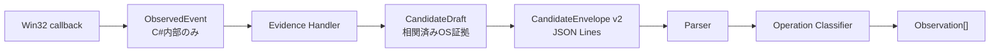

# 05 コンポーネント間の契約・インターフェース・状態所有（Step 2）

> **後続決定（2026-11-06）**：本書の`IEvidenceHandler.OnEvent()`等は検討途中の形。**調停・所有権・CandidateDraftの採用契約は[10](10-architecture-decisions.md)・[11](11-routing-and-ownership.md)を優先**。この文書の未確定・注意書きを単独でIssue仕様にしない。

> **設計案・擬似コード**。実在するC#の型やファイルをそのまま示すものではない。基準：[Step 1の現状調査](03-dependencies.md)。採用順・既存動作の固定はStep 3/4で確定する。

## 1. 主要な4種類のデータを分ける

| 型（提案名） | 作成者 → 利用者 | 最小の情報 | どこまで外部に出すか |
| --- | --- | --- | --- |
| **ObservedEvent** | C# Observer → Dispatcher → Evidence Handler | イベント種別、単調増加時刻、native対象ID、必要な入力フラグ、窓の前後snapshotまたは照会手段 | **C#プロセス内だけ** |
| **CandidateDraft** | C# Evidence Handler → Candidate Sink | **transaction**、origin、route、OSの**Evidence**、時刻/日付、注入・競合等の判断材料 | C#内の候補の共通出力契約 |
| **CandidateEnvelope** | CandidateProtocol → Main Parser | `type`/`protocolVersion`/`generation`/`sequence`/`transaction`/`date`/`origin`/`route`/`injected`/`conflicted`/`evidence` | **C#↔TSのJSONL境界**。初期工程では現行v2を維持 |
| **Observation[]** | TS Operation Classifier → DurableCoach | operation（W ID）、origin、shortcut（nullable）、date、monitor等 | 製品内の記録・通知に使用 |

※`ObservedEvent`は意図的に生データを含み得るが、**決してそのままJSONLに流さない**。キー入力列、文字、窓タイトル、clipboard、URL、HWND/プロセスIDや**生のカーソル軌跡**等を送信・保存する設計にはしない。ただし既存protocol v2はモニター境界の`x/y/width/height`を含む。**モニターの幾何情報と個々のマウス座標を混同しない**。必要なWin32値は観測時に読み取り、Nativeで最小限のEvidenceに要約する。

### 変換パイプライン



## 2. 共通インターフェースの最小案

次は**仕様上の形の例**。名称、引数、値オブジェクトの詳細は実装Issueで調整可。ただし責務・所有権の変更は設計レビュー対象。

```csharp
// Native内部だけで使うイベントの判別可能な型。
// MouseObserved / KeyObserved / WindowObserved / ProbeTick / EnvironmentChanged 等。
abstract record ObservedEvent(long MonotonicMs);

// イベントを受け取る契約。OS APIやCandidateProtocolは知らなくてよい。
// ここでは配送の形だけ示す。所有権・競合調停のAPIは未設計。
interface IEvidenceHandler
{
    EventKind Interests { get; }
    void OnEvent(ObservedEvent observed, IDetectionContext context);
    void Reset(ResetReason reason);
}

// 必要な共通サービスを狭く公開する。
// event時点の窓情報はsnapshot/cacheを優先し、独立したOS再取得は制限する。
interface IDetectionContext
{
    IWindowFacts WindowFacts { get; }   // Native専用。要求時の情報は既知のevent時点に結び付ける。
    ITransactionIds Transactions { get; }
    ICandidateSink Candidates { get; }
}

// 送信窓口。各Handlerはprotocol v2の作成法を知らない。
interface ICandidateSink
{
    void Emit(CandidateDraft draft);
}

// CandidateDraft は Evidence、Transaction、Origin、Route、Date、Injected、Conflicted等。
```

- **Event Dispatcher（具象クラス）**が`IEvidenceHandler`の登録一覧を持ち、`Interests`に合うイベントを**順序確定済みで同期配信**する。
- 依存性逆転の位置は **Observer/Dispatcher → `IEvidenceHandler`** と **Handler → `ICandidateSink`**。Dispatcher自体がinterfaceという意味ではない。
- `Observer`はNative OSからイベントを取得して型付けする。**最大化Handlerの名前やメソッド`FinishMove`等を知らない**。
- `ICandidateSink`の実装は`CandidateProtocol`へ委譲し、`generation`・`sequence`・**候補発行順を守る`gate`**を維持する。**JSON直列化と標準出力書込用の`outputLock`は引き続き`ObserverHost.Emit`**に置く。既存の`Switch/Taskbar/Complete`の公開メソッドを直ちに削除せず、適合アダプタを挟んでよい。
- **`IWindowFacts`はWin32の読み取り側の境界**であり、必ず全APIをラップする大きなinterfaceにするわけではない。現行で必要なsnapshot・hit testなどの読み取りに限定する。

### Dispatcherの未確定契約（実装着手前に解決）

上の`IEvidenceHandler.OnEvent()`は**単純な受信インターフェースの例**であり、これだけではObserverが現在行う`captionClick`→`switching`取消、ドラッグ開始時の所有権移譲、W12専有、他候補抑制を表現できない。**調停を単なる登録順やHandler内の独自判定任せにしない**。Step 3の[G01](08-test-coverage.md)を本番の配送/調停経路に対する回帰テストとして固定し、Step 4で少なくとも「イベント専有・他Handler取消・複合結果のオーナー・Resetと遅延結果」の責務と通知方法を**確定してからDispatcherを導入**する。必要ならインターフェースに処理結果・所有権の通知を追加する。ここでは戻り型を決定しない。

### Event Dispatcherの注意

`OnMouse`/`OnKey`の低レベルHookはすぐにWindowsへ制御を返す必要がある。Dispatcher・Handlerはイベント処理時に同期ネットワーク/ディスクI/Oや長いUIA呼出しを行わない。長い確認は既存のtimer/worker方式を維持し、結果だけを**制御しているスレッドへ戻して**期限・世代を検証する。`ProbeTick`等はOSの生イベントではなく、内部から発行する観測イベントである。

**追加登録**：操作別Handlerを追加するときの変更は原則「新Handler・その登録・操作型/契約が新規なら対応するschema・TS Classifier」。既存Handlerを再編集しなくて済むことを目指す。ただし新しいWindows API種別を使う場合はOS Adapterに追加作業が必要。

## 3. Stateの所有者を明確にする

| 状態・仕組み | 推奨所有者 | 理由・注意 |
| --- | --- | --- |
| Win32 Hookとcallback、OSごとのadapter、設定変化 | Observer / Adapter | OSとの境界の責務 |
| WindowStateの時点付きsnapshot/キャッシュ | Native WindowFacts | Detector間で同じイベントのsnapshotを共有し、不用意な再取得や競合を避ける |
| イベントの順序・配信・登録済みHandler一覧 | Dispatcher | 操作名を知らず順序を制御 |
| `generation`とプロセス観測の開始停止 | ObserverHost＋Observer session | 停止後の古い結果を無効化 |
| **共通transactionの採番** | **ITransactionIds**（CandidateTrackerから分離） | 専用Observerの`tracker.NextTransaction`依存だけでなく、**CandidateTracker内の`++transaction`**（`Mouse`/`Key`/`Build`等）をすべて移す必要がある。世代切替でリセットし、全Handlerで番号の一意性を保つ。**候補未確定・取消によるtransactionの欠番は許容し、連番を強制しない** |
| マウスの最大化候補、drag状態、switch/close、タスクバー照会など**固有のpending** | それぞれのEvidence Handler | 独立した操作は独立した状態で持ち、巨大な全局stateに統合しない |
| 複数Handler間の取消・所有権・複合確定 | 明示的な**Arbitration/Compatibility Policy**（小さい共通制御） | 現行の優先順序と抑制を**変えず**移す。勝手に全件fan-outしてはいけない |
| Candidate送信順`sequence`、CandidateEnvelope、候補発行の`gate` | CandidateProtocol / Sink | 各HandlerがJSONLと送信順を知らない。標準出力への書込lockは`ObserverHost`に分ける |
| TypeScriptの受信行buffer・child process | ObserverClient | IPC/失敗時停止 |
| `sequence`/transaction重複、Observation原子保存 | DurableCoach | 一度消費したgestureを二重加算しない |
| W ID/代替キーの判定関数 | TS Classifier | **状態を持たない**ことを基本とする。gesture間の製品単位統合を移す場合のみ別の明示的session stateを検討 |

### 競合・複合操作に関する不変条件

- **単純なブロードキャスト≠正しい操作判定**。現在の`Observer`に存在する取消・抑制順序は、回帰テストに固定してからArbitration/Compatibility Policyに移す。
- **1つの物理ジェスチャから複数のW IDが成立してよい**。例：非アクティブのcaptionクリックによるW01＋W03/W04、別ディスプレイへのドラッグによるW02＋W03/W07。
- `DurableCoach`はCandidateの`transaction`をClassifier実行前に消費するので、同一transactionでCandidateを連続送信するのは不可。**既存のv2における1transaction＝1CandidateEnvelope、その中で複数Observationへ分類**を維持する。
- `ICandidateSink.Emit`は、**同一transactionの複数の部分成果を個別に送らない**。現行の`caption-click`/`compound-drag`のように複数結果を一つのEvidenceへまとめる。**非アクティブcaptionの複合候補は専用Handler、複合ドラッグはWindowMove系Handlerを最終確定の所有者とし、他Handlerからの派生候補を抑制する**。二つのHandlerが同一transactionで各1Candidateを出し、TS側で合成する方式にはしない。（将来「複数Evidenceを1Envelope」は新しいwire契約の議題とし、現段階では採用しない。）
- handlerの例外・破損・期限切れは**誤採用をせず、pendingを破棄**する。停止・generation切替ではtimer、非同期照会、pendingを無効化し、stale結果が次世代へ入らない。
- 将来のアダプタ・検出器は**監視データの必要最小化**を維持し、文字列やキー列の常時記録を導入しない。

## 4. C#のCandidateTrackerをどの責務へ分けるか（論理案）

| CandidateTrackerの現行処理 | 提案する責務の所有者 | 対応する現行関数・状態 |
| --- | --- | --- |
| 共通transaction採番 | `ITransactionIds` / session | `NextTransaction()`、`Mouse`/`Key`/`Build`等での直接的な`++transaction`、`PlacementPolicy`へ渡す採番callback、専用Observer向けcallback |
| マウス・キーの正規化、イベント時点snapshot | Observer / WindowFacts | `OnMouse`/`OnKey`からWindowStateやhit testを取得する経路 |
| 最大化・最小化・復元のpending、Win+↑/Win+↓系列 | **WindowState Evidence Handler** | `input`/`winUp`/`completedWinDown`、`ConfirmMaximize`、`Complete`の一部 |
| ドラッグpress・移動開始終了・monitor間の証拠 | **WindowMove Evidence Handler** | `dragPress`/`drags`/`release`、`MoveStart`/`FinishMove`の一部 |
| 左右半分・四隅の配置判定 | **Placement Evidence Handler** | `PlacementPolicy`、`PlacementGeometry`、`FinishKey`の一部 |
| 非アクティブcaptionの切替＋窓状態 | **InactiveCaption Evidence Handler** | `InactiveCaptionPolicy`に相当 |
| ウィンドウ切替・閉じる・タスクバー | **既存の専用Observer/Policyをラップまたは適合** | `WindowSwitchObserver`/`WindowCloseObserver`/`TaskbarInputObserver` |
| 候補の競合・取消、同期的な受け渡し順序 | **小さなArbitration/Compatibility Policy** | 現行ObserverとCandidateTrackerに散る横断ルール |

**クラスを今すぐこの名前で新設する指示ではない**。処理を1件ずつ移動する前にStep 3でライフサイクルと優先条件をテストで固定する。

## 5. TypeScriptのClassifierをどう分離するか

- `src/core/detector.ts` の`classifyGesture`を**共通入口**として維持。
- `evidence.kind`単位または強く結び付いた証拠群単位で、**純粋関数**の採用ルールをファイルに分離する。例：`classifyWindowEvidence(candidate)`、`classifySwitchEvidence(candidate)`、`classifyCompoundEvidence(candidate)`。
- 多対一（複数Evidence種別→同じW ID）と一対多（caption-click→複数W ID）を許す。**W IDを主キーとして1 Handler＝1 Operationを強制しない**。
- 共通の`date`、`generation`、`injected`、`conflicted`等の**形式検証はMain Parserと適切な共通ガードに集約**。製品上の「そのEvidenceでW IDとキーが妥当か」は各Classifierで判定。
- 新しいwireの`evidence.kind`を追加する場合、C#の型・TS shared union・Main parser・Core classifierの更新が必要。**プロセス間の契約変更は正当な変更**であり、OCPのために無検証の動的JSONへ変えない。

**互換条件**：`ObserverCandidate`のv2を保ち、入口が`Observation[]`を返すことを維持。現行`DurableCoach`は最大2件保存できる作りのため、3件以上が必要な新複合操作は別途永続化設計を伴う。Step 2で無断に上限を変更しない。
