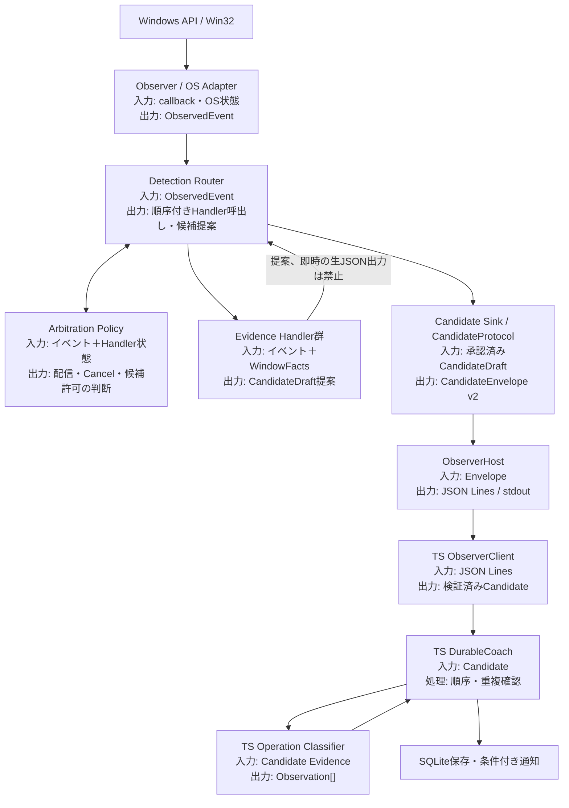

# 10 目標構成の確定判断（Step 4のIssue分割に入る前）

> **状態：設計判断を確定（実装未着手）**。2026-11-06の`main` [4f40cbea](https://github.com/YutoMatsui21/shortcut-expert/tree/4f40cbea0cce2c675339b0be3f37d1d2ca013a95)を再調査し、[09 レビュー結果](09-review-audit.md)の未確定事項を解消するための決定。実装コードのAPI名・ファイル分割の小さな変更はCodexに任せられるが、**ここに記載した責務・データ境界・競合条件は変更しない**。現行製品仕様の正本は[製品要件](../../ui-requirements.md)。

**目的**：新しい操作を追加する際に、Observer・他の操作用Handler・送信処理の変更を最小化し、変更理由が明確な構造を作る。**先に責務の境界、後から実装Issue**を決める。

## 1. 最終的に目指す構成

- **Routerは具体的なクラス**、`IEvidenceHandler`は共通の契約、`ArbitrationPolicy`は**操作間の競合と配信順のルール**。それぞれ異なる責務であり、「interface=Dispatcher」ではない。
- **Candidateの最終発行は一つのSinkを経由**。Handler内で`CandidateProtocol.Switch/Close/…`や`Console.WriteLine`を直接呼ぶ構造は段階的に廃止する。
- **Window観測とは別にText観測のOS Adapterを追加可能**にする。Windows窓の`WindowState`をテキスト操作へ流用しない。

## 2. 解決した設計判断

| ID | 論点 | 決定 |
| --- | --- | --- |
| **D01** | C#とTSの境界 | **C#：Win32入力と結果の相関、Evidence確定。TS：製品上のW ID・案内キー・記録/通知。** 生イベントをTSへ送らない。最初の構造変更では**wire protocol v2を完全維持**し、意味付けを移す変更は今回行わない |
| **D02** | NativeのHandler粒度 | **WindowGesture**（状態変化・ドラッグ・方向キー配置）、**InactiveCaption**、**WindowSwitch**、**WindowClose**、**Taskbar**の5領域。**WindowGestureの中身をいきなり3つの独立した状態機械に分けない**。入力状態が複数の判定で共有されるため、境界を固定してから内部のPolicyを必要な範囲で分離する。`SnapInvocation`は登録しない |
| **D03** | Observerと検出器の境界 | ObserverはHook登録/解除、イベントの型付け・必要時のWin32事実取得に限定。**操作ごとのCancel/確定メソッドを直呼びしない**。Handlerは`IEvidenceHandler`に従いRouter経由で呼び出す |
| **D04** | Dispatcherと調停の方法 | **単純な一斉配信は不採用**。同期`DetectionRouter`＋単一`ArbitrationPolicy`を採用し、既存の呼出し順・専有・例外的な並行追跡を**段階的な配信計画**で再現。詳細なイベント別ルールは[11 配送・調停契約](11-routing-and-ownership.md) |
| **D05** | 複合操作の最終所有者 | **InactiveCaption Handler**がW01＋W03/W04の証拠、**WindowGesture Handler**がW02＋W03/W07の証拠を、それぞれ**単一Candidateにまとめて確定**。途中状態を別Handlerから送らない。`DurableCoach`の「同じtransactionの2候補目は棄却」を前提に維持 |
| **D06** | 状態の所有者 | Win32 snapshot/cacheは`WindowFacts`、各操作のpendingは各Handler、**イベント配信・取消・候補の許否**はRouter/Arbitration、transaction採番はsession、generation/sequence/envelopeはProtocol、stdout書込lockはHost。**巨大な共通Gesture Coordinatorは作らない** |
| **D07** | transaction ID | **sessionごとの単一採番器**を導入する。`CandidateTracker.NextTransaction`だけでなく、`Mouse/Key/Build`の`++transaction`、Placementの採番callback、専用Observerのcallbackをすべて移行。**確定前に採番された候補の取消で欠番が生じてもよい**。CandidateEnvelopeにはこれまでどおり正整数を1つ付ける |
| **D08** | Handler→protocolのデータ | **既存のC# `Evidence`サブタイプを再利用**する内部`CandidateDraft`を採用。既存`CandidateProtocol`で`CandidateEnvelope`（v2）に変換する。新しい汎用raw eventのJSONスキーマ、v3、TSへの生情報転送は作らない |
| **D09** | 状態snapshotと時間 | **必要時にだけWin32を読む**。OS Adapter/WindowFactsが既存のキャッシュ・hit-test・タイミングを保持し、mouse moveごとの全面snapshotは作らない。押下前/後のsnapshotを混ぜない。各Handlerのtimeout/発火時刻・50ms timer・Taskbar非同期workerの挙動を維持 |
| **D10** | ライフサイクル | HandlerのStart/Stop/Cancelを共通契約で呼び、**Stop時にpendingと世代を失効**させる。既存timer/workerがあるHandlerは独自に保有できるが、結果は**同じ観測スレッドのRouter→Sink**を通し、generation照合を再実施する |
| **D11** | TypeScript側 | `src/core/detector.ts`の`classifyGesture`を共通入口として維持。`evidence.kind`群ごとの**純粋関数に分離**（W IDごとに1ファイルを強制しない）。`DurableCoach`の順序・重複・2件の原子保存は変更しない |
| **D12** | 製品上の意味の移動 | **今回行わない**。連続`Win+↓`の1操作への統合、対象窓フィルタ等をTypeScriptへ移すと候補発行・ジェスチャ境界が変わる。必要性が判明した場合のみ、別の仕様変更として設計する |
| **D13** | 新規Handlerの追加方法 | `DetectionComposition`（composition root）1か所で登録する。**既存HandlerとObserverのコードを原則変更しない**。新しい競合・複合関係がある場合に限りArbitrationPolicyへ規則追加することは正当な変更 |
| **D14** | 実装の移行・検証 | **旧動作のテスト固定→Sink/採番境界→WindowGesture/専用Handlerの適合→Router＋調停→TS Classifier分割**の順で段階的に移行。各境界で現行のCandidate・採用・SQLite・通知を比較。[12 移行・受入条件](12-migration-and-gates.md)を使い、Step 4のIssueに落とす |

**設計上の意図**：D02は「WindowState/Move/Placementをこれ以上分けてはいけない」ではない。今回の完了条件としては、共有する入力・取消を壊さず**1つのWindowGesture Handlerに閉じ込めるところまでを必須**にし、内部を独立したHandlerに分けることは**このリファクタの必須条件にしない**。これが、拡張性と既存機能の安全性のバランス。

## 3. 一般化する境界と、一般化しない境界

- **一般化する**：`ObservedEvent`の配信、handler登録とライフサイクル、Nativeの候補発行、session内transaction採番、C#/TSの形式契約。
- **個別のままにする**：クリック/ドラッグ/Alt+Tab/タスクバーの具体的な状態機械、OSとの照合条件、Policyのtimeout、例外的な複合成立条件。
- **一か所に集約する**：複数Handler間の優先・取消・候補発行の調停と、「複合の最終候補をどちらが所有するか」の規則。
- **採用しない**：全イベントを何も考えず配るbus、1操作=1Handlerの強制、WindowState・Text操作に共通な巨大状態型、TypeScript側でのWin32イベント再構築、全状態を持つ単一Coordinator。

## 4. D01の具体例

C#からの`Evidence`は「同じウィンドウで、入力に対応する`normal→maximized`を確認した」という**OSに関する事実**を持つ。TSのOperation Classifierはそれを`W03`として採用し`Win + ↑`を案内するか判断する。**C#に`maximize`という文字列があることは、責務の越境ではない。**

ただし、同じ1ジェスチャをどこで統合してCandidateとして発行するかは**Nativeの時間相関管理と密接に結び付いている**。今回はその境界のまま維持し、製品の意味を変える話と混ぜない。

## 5. 利用する文書

- [11 配送・調停・複合候補の契約](11-routing-and-ownership.md)
- [12 移行順序と受入ゲート](12-migration-and-gates.md)
- [09 修正されたレビュー指摘](09-review-audit.md)
- [07 回帰条件](07-regression-contract.md)と[08 テスト対応表](08-test-coverage.md)

**設計はここで決定するが、テストによる実証はまだない。** 実装中に現行コードの未確認の相互作用が見つかれば、検出条件を勝手に変えず、D04/11の契約に合うよう設計文書を更新したうえで実装する。
