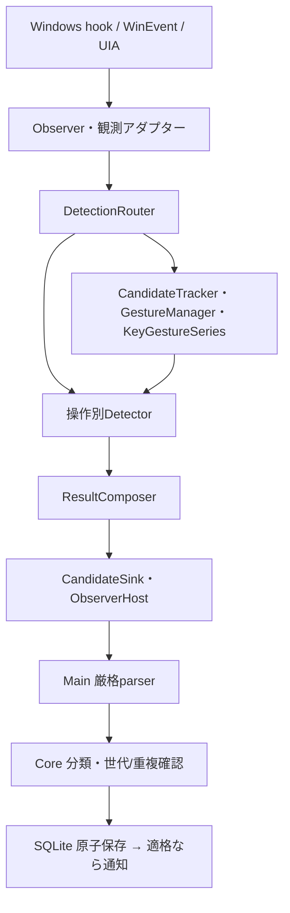
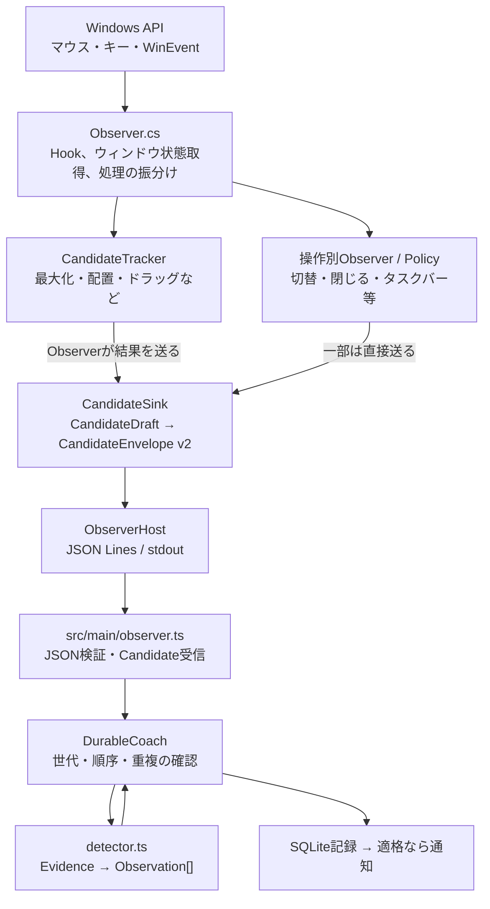

# 現在の検出アーキテクチャ

## 現行の本番経路（#186）



8操作の本番候補は、成立したProofを含むv2の `independent-results` で送る。Trackerは入力・配置系列の記憶、対象の同定、取消を担当し、候補の生成は各DetectorとComposerが担当する。Observerは共通の観測、状態取得、入力源による配送・取消、タイマーを扱う。別画面へのドラッグで最終halfも確証できればW02とW06を採用する。同じ画面のhalfはW06として扱う。共通入力が有効な複合操作は、個別に成立したProofだけを同一transactionにまとめる。

旧モードへの環境変数切替と旧候補の本番発行を撤去した。旧v2の読取・分類は維持し、固定baselineと研究probeで使う旧生成コードは製品ビルド外へ移した。送信には入力列やウィンドウ識別情報を含めず、世代・sequence・transactionを照合して保存後に通知する。

`IndependentDetectorRegistrationTests.cs` は、既存の観測イベントから仮Detectorを同じRouterへ登録し、既存の出力が一致すること、同一Sinkで追加候補が採番されること、Stop後は配送されないことを検証する。新しい観測事実やEvidenceが必要な場合は、観測元または通信契約の拡張が必要になる。画面構成・設定の変更通知はRouterを通じてW12にも配送し、保留中の入力と変更前のUIAスナップショットを無効化する。実機検証の実施範囲は[PR #206](https://github.com/YutoMatsui21/shortcut-expert/pull/206)を参照。

## 移行前の構成（2026-11-06）

以下の基礎図表は[当時のコード](https://github.com/YutoMatsui21/shortcut-expert/tree/c1203ec79cf0976a2dad1e65b8c2451fcbe14ef7)を記録したもの。後続の節は各Issueで導入した構成を記録する。

### 処理の全体像



**C#からTypeScriptへ送っているのは生のOSイベントではなく、入力と結果を照合したCandidate**。1行につき1つのJSONオブジェクトを標準出力に送る（ディスク上にJSONLファイルを作るわけではない）。

## 各コンポーネントの入力・出力

| 現行コンポーネント            | 入力                                                                                                                       | 出力・役割                                                                                                                     |
| ----------------------------- | -------------------------------------------------------------------------------------------------------------------------- | ------------------------------------------------------------------------------------------------------------------------------ |
| `Observer.cs`                 | `OnMouse`（低レベルマウス）、`OnKey`（低レベルキー）、`OnEvent`（foreground／位置／移動開始・終了／最小化／破棄等）、timer | Win32でウィンドウ状態・押下対象等を読み、各Tracker/Observer/Policyの**具体的なメソッドを順序付きで呼ぶ**。状態キャッシュも保持 |
| `CandidateTracker.cs`         | 入力、押下時のウィンドウ状態、WinEventによる状態変化・経過時間                                                             | `WindowCandidate`／`PlacementResult`／`CompoundMoveResult`。最大化・復元／最小化、配置、ドラッグ・画面移動の候補               |
| `WindowSwitchObserver/Policy` | キー・クリック・foreground・timer                                                                                          | 切替が成立すれば`protocol.Switch`                                                                                              |
| `WindowCloseObserver/Policy`  | 閉じる入力・ウィンドウの存続/DESTROY・timer                                                                                | 閉じる確証があれば`protocol.Close`                                                                                             |
| `TaskbarInputObserver`等      | タスクバークリック／Win+数字・UIA snapshot・非同期確認                                                                     | `protocol.Taskbar`                                                                                                             |
| `InactiveCaptionPolicy`       | 非アクティブウィンドウクリック・foreground・最終ウィンドウ状態                                                             | `Observer`のtimer経由で`protocol.CaptionClick`                                                                                 |
| `CandidateProtocol.cs`        | 上記の各種候補結果                                                                                                         | Evidenceを含むv2 `CandidateEnvelope`、generation・sequence・発行順（`gate`）                                                   |
| `ObserverHost.cs`             | Envelope・制御コマンド                                                                                                     | JSON直列化とstdoutへの書込み（`outputLock`）                                                                                   |
| `src/main/observer.ts`        | helperのstdout行                                                                                                           | `candidateV2`で形式を検証した`ObserverCandidate`                                                                               |
| `src/core/durable-coach.ts`   | 検証済みCandidate                                                                                                          | generation／sequence／transactionの重複を確認し、分類後の原子保存・通知判定                                                    |
| `src/core/detector.ts`        | Candidateと`evidence.kind`                                                                                                 | 0～2件の`Observation`（操作ID、入力由来、案内キー等）                                                                          |

C#側の`WindowCandidate`内部に古い`protocolVersion=1`表記があっても、外部送信前に`CandidateProtocol`が**v2へ変換する**。この内部型と通信形式を混同しない。

## どこで状態を保持しているか

| 状態                                                                    | 現在の所有者                                              |
| ----------------------------------------------------------------------- | --------------------------------------------------------- |
| Hook、ウィンドウ状態のキャッシュ、入力ルーティング・取消順序、50ms poll | `Observer`                                                |
| 入力／ドラッグ／Win+↑・↓の候補、配置シリーズ、transaction採番           | `CandidateTracker`（配置は`PlacementPolicy`も状態を持つ） |
| 背後ウィンドウcaptionのクリック候補                                     | `InactiveCaptionPolicy`                                   |
| 切替・閉じる・タスクバーの候補、専用timer/worker                        | 各専用Observer／Policy                                    |
| generation、送信sequence、Envelopeの発行                                | `CandidateProtocol`                                       |
| stdout書込・helperの起動制御                                            | `ObserverHost`                                            |
| 子プロセス、行バッファ                                                  | `ObserverClient`                                          |
| 再配送排除、記録、通知の適格性                                          | `DurableCoach`                                            |

## 機能追加時に変更が広がりやすい理由

- **Observerが個別実装を知る**：`tracker.Complete/FinishMove`など、操作ごとに呼出し条件・戻り値別のProtocol呼出しがある。
- **Trackerの責務が広い**：最大化・キー系列・ドラッグ・配置が押下/取消状態を共有している。
- **競合処理が分散**：通常切替・背後ウィンドウcaption・ドラッグ・タスクバーは、`Observer`が特定順でCancel/抑制する。
- **候補の出口が複数**：Trackerの戻り値はObserverが送る一方、専用Observerの一部はProtocolを直接呼ぶ。
- **TSの分類が集中**：`classifyGesture`の内部でEvidence種別により分岐する。

ただし、これらが**直ちに不具合であるという意味ではない**。特に既存の競合・取消順序には誤採用防止の理由がある。目的は振る舞いを変えずに変更箇所を局所化すること。

## 現行で注意が必要な操作

- **非アクティブcaptionクリック**：ボタン不明時は通常のドラッグ候補と**並行追跡**でき、`MOVESIZESTART`ではクリック候補を取り消す。単純な先着専有ではない。
- **複合ドラッグ**：画面移動＋最大化／四隅は**1つのCandidateから2つのObservation**を生成し、中間の復元等を別計上しない。
- **Win+数字**：タスクバー候補の経路を優先し、通常切替へ二重計上しない。
- **確証のない案内**：操作の記録と、等価なショートカットの案内は別判定。特にW02は移動が確証済みなら方向不明でも記録し、キー案内を`null`にできる。

操作の具体的な成立条件は[操作別設計](../../operations/README.md)を正本とする。

→ **新しい構成は[目標アーキテクチャ](target.md)**。

## Candidate Sink導入時（Issue #173）

All production candidates pass through `CandidateSink.Submit(CandidateDraft)`. The existing operation adapters construct drafts; only Submit assigns the wire sequence and invokes the output callback under the generation gate. ObserverHost retains its outputLock. Transaction IDs remain input IDs assigned by existing policies; cancellation and duplicate completion prevention remain in those policies, and delivery deduplication remains in DurableCoach.

| Candidate source                                           | Sink adapter         |
| ---------------------------------------------------------- | -------------------- |
| Observer / CandidateTracker: window state and monitor move | Complete             |
| Observer / CandidateTracker: placement and compound drag   | Placement / Compound |
| Observer / InactiveCaptionPolicy                           | CaptionClick         |
| WindowSwitchObserver                                       | Switch               |
| WindowCloseObserver                                        | Close                |
| TaskbarInputObserver                                       | Taskbar              |
| SnapInvocationObserver: non-product validation route       | Invocation           |

`CandidateProtocol.V2` is now a pure legacy evidence converter. WindowCandidate's internal sequence remains for legacy policy fixture compatibility and never controls wire numbering. The independence comparison fixtures also use CandidateSink; direct V2 conversion fixtures do not emit output. The pre-refactor component descriptions above refer to CandidateProtocol; their emission responsibility now belongs to CandidateSink.

The fixture-only `ObserverHost.fixtureCandidate` command deliberately bypasses the sink to inject exact envelopes into TypeScript, preserving parser/replay tests. Control responses and bounded diagnostic aggregates are not candidates and still use Host output directly. No raw input or window identity is added to drafts or JSONL.

## GestureManager（Issue #175）

`Observer`は引き続きWin32の観測・WindowState取得・配送順序・pollを担当する。取得済みsnapshotと観測時刻をTracker経由で`GestureManager`へ渡す。hook内のOS照会は増やしていない。

`GestureManager`は、Trackerの入力・物理press・移動中対象・drag・release・Win+Up候補の共通管理元になった。共通GestureはローカルID、generationとResetごとのrevision、入力源、対象、開始snapshot、物理性・修飾状態、最新foreground、解放時刻、終端snapshotを持つ。snapshotの時刻は同じ単調時計の観測時刻。IDはtransactionと別で、`DetectionSession`の採番やSinkのsequenceを変更しない。完了済み・取消済み・期限切れ・別Gesture・Reset前の参照への完了要求は拒否する。履歴を蓄積せず、現在のGestureと既存Policyが必要とする参照だけを保持し、外部送信・保存しない。

物理pressからMOVESIZESTARTで作るdrag入力は同じGestureを参照し、従来のinputAgeMs用の時刻変換は互換入力にだけ適用する。Win保持中のPlacement系列も同じGestureと開始snapshotを参照し、途中のWin+Up候補を作っても共通IDを作り直さない。入力終了は`awaiting-result`、Policyの終端処理は`completed`または`cancelled`とし、期限の選択は既存Policy側に残す。

### 今回残した責務

- Trackerのroute分類、クリック距離・ダブルクリック・キーrepeat／注入キー、Win+Down継続判定、診断probe、操作固有の期限と成立条件は既存のまま。互換`Input`のroute・transaction・Conflicted等は既存判定のために残し、共通Gestureに操作の成否を格納しない。
- PlacementPolicyの形状系列・heldキー・期限は残し、開始／解放／完了／取消のみ共通寿命へ接続した。
- 背後captionは既存の並行追跡・foreground照合を維持する。W11のDESTROY待ち、W12の非同期UIA、W01/W12排他と各workerの寿命は専用Observer／Policyに残す。それらの入力を共通Gestureへ移す作業は後続のRouter／独立Detector移行で扱う。
- GestureManagerの完了はCandidateの送信ではない。既存PolicyがCandidateを返し、CandidateSinkが世代・送信順を管理する。検出条件、途中計上の抑制、Protocol v2、TS分類、保存・通知は変更していない。

人工入力の共通寿命と本番Trackerへの接続は`GestureTests.cs`、Native出力の互換性は#172の固定baselineと既存Policy試験で検証する。自然入力・実OSのイベント順序・通知表示の受入とは区別する。

## DetectionRouter（Issue #176）

本番では、Observerが取得した共通イベントを`DetectionRouter.Dispatch`へ渡し、登録された互換アダプターが既存処理へ変換する。Routerは購読種別と登録順に同期配送するだけで、成立判定・優先順位・相互取消・Candidateの合成は行わない。

```text
Windows hook / WinEvent / 50ms poll
  → Observer（既存位置でWin32観測、WindowState取得、排他・取消）
  → ObservedEvent → DetectionRouter
      → DedicatedInputAdapter → TaskbarInputObserver → WindowSwitchObserver → WindowCloseObserver
      → TrackerEventAdapter → CandidateTracker / PlacementPolicy / GestureManager
                            → CandidateSink → ObserverHost
```

上の専用Observer間の矢印は従来の呼出し順を表す。独立Detectorへ変換した意味ではない。各専用Observerは従来どおりCandidateSinkへ出力する。

### 移行した配送と観測順

| 入口                            | Routerに配送する内容                                                                           | 保持した観測・処理順                                                                                                                                                                                       |
| ------------------------------- | ---------------------------------------------------------------------------------------------- | ---------------------------------------------------------------------------------------------------------------------------------------------------------------------------------------------------------- |
| mouse hook                      | `MouseMessageEvent`、`RawMouseEvent`、`MouseMoveEvent`、`MouseReleaseEvent`、`MousePressEvent` | caption継続処理 → Trackerのmessage処理 → release probeの開始観測 → W12/W01/W11入力 → 移動／解放 → 押下対象・hit test取得 → caption admission → Tracker押下。各段階は別イベントで、同じ処理を二重配送しない |
| key hook                        | `RawKeyEvent`、`KeyReleaseEvent`、`KeyResultEvent`、`KeyPressEvent`                            | caption／mouse-state取消 → W12/W01/W11入力 → Win+数字除外 → 解放 → 必要な終端snapshot取得／FinishKey、または開始snapshot取得／Key                                                                          |
| foreground                      | `ObservedKind.Foreground`、必要なら後続の`StateObservedEvent`                                  | caption照合 → closing.Event → Tracker.ForegroundChanged → switching.Foreground → 状態取得・確定                                                                                                            |
| MOVESIZESTART                   | `ObservedKind.MoveStart`                                                                       | caption取消 → closing.Event → switching.Cancel → Tracker.MoveStart                                                                                                                                         |
| MOVESIZEEND                     | `MoveEndEvent`                                                                                 | 既存位置で終端snapshot取得 → FinishMove → 状態cache更新 → 既存の結果種別に応じSink送信                                                                                                                     |
| DESTROY                         | `ObservedKind.Destroy`                                                                         | caption処理 → closing.Event（W11確証）→ 対象とOBJID_WINDOW/CHILDID_SELF確認 → Tracker.Forget → cache削除                                                                                                   |
| 状態変化／mouse解放後のfallback | `StateObservedEvent`                                                                           | 既存位置で前後snapshot取得・cache更新 → caption対象除外 → Tracker.Complete → Sink                                                                                                                          |
| 50ms poll                       | `TickEvent`                                                                                    | caption poll → Trackerの対象・process確認 → 終端snapshot取得 → ConfirmMaximize → cache更新 → Sink                                                                                                          |

イベントの`At`は既存の単調時計、`InputTime`は既存のOS時刻で、用途を混ぜない。WindowStateは取得済みsnapshotで、Routerに新しいOS照会を追加していない。生入力・対象・snapshotを保存や通信へ追加しない。

### 配送と非同期完了の境界

`Subscribe`にイベント種別とハンドラーを登録すれば、Observerへ操作専用分岐を増やさず受信できる。同期処理は`Processed`となる。ハンドラーが`Delivery.Await`を使った場合は`AwaitingResult`となり、購読先が保持する有効性述語とGesture、generation、対象HWND、process、入力源を照合して、`Complete`が完了通知を一度だけ呼ぶ。`Cancel`、Stop、同じgenerationへのResetも旧完了を無効にする。購読登録はStop/Resetで保持する。Routerは処理中の参照だけを保持し、完了・取消時にはpending集合から削除する。

全APIは作成元のmessage-loopスレッドに限定する。workerは元スレッドへpostしてから完了を通知する契約で、別スレッドからの完了要求は拒否する。この完了APIは将来のDetector向け境界で、現行W11/W12の非同期処理を置き換えていない。既存アダプターの`Processed`は配送済みを意味し、操作成立やGesture終了を意味しない。

### 意図的に残した経路

- ObserverのOS取得、対象cache、captionの並行追跡と排他、`ClearInput`／`CancelMouseState`／不正状態時の`Forget`、`MaximizeTarget`／`MaximizeProcess`等の照会、timer有効化は残す。取得と取消が交互に行われる既存順序を保ち、成立条件は変えない。
- `closing.Event`、`switching.Foreground`と各専用ObserverのStart/Stop、timer、W11のDESTROY待ち、W12のUIA worker・完了post・対象／generation照合は既存のまま。これらをRouterのpending状態へ統合しない。W01/W12排他も各既存処理に残す。
- captionのStart/Mouse/State/Foreground/Poll、専用Observer内のWin32/UIA取得とSink出力、検証専用Snap経路は未移行。今回の対象は配送の分離であり、8操作の独立Detector化やResultComposer、Protocol変更は行わない。

`RouterTests.cs`で購読・順序・処理状態・対象／process／入力源／Gesture不一致、取消・Stop/Reset・別スレッドの完了、TrackerとGestureManagerの共存、キー／poll／破棄の互換性を検証する。#172の既存baselineは変更せず、既存ドラッグfixtureもRouterと旧形式の試験用アダプターで再生し、Candidateの件数・順序とEnvelope全体を直呼び出しと比較する。W11/W12等の未移行状態機械は既存Policy・helper結合試験で保護する。これらは隔離fixtureの証拠で、自然入力や実OSの順序・通知表示の受入ではない。

<a id="independent-detectors-180"></a>

## W02・W03・W07の独立判定導入時（Issue #180）

通常起動では `IndependentOperationAdapter` をRouterの互換配送に接続する。物理入力の開始時に `OperationResultSession` が3つの購読を固定し、`MonitorMoveDetector`・`MaximizeDetector`・`QuarterPlacementDetector` が共通の入力・終端snapshotだけを評価する。他Detectorの結果は参照しない。`KeyGestureSeries` は旧PlacementPolicyから取り出したWin保持列の中立factsを持ち、未移行のW06も同じfactsを使う。

ドラッグはMOVESIZEEND、Win保持配置列は両Win解放後、Shift付きmonitor移動は方向キー解放後の結果で確定する。W03のキーとクリックも未解放では発行しない。W03の通常キーは入力から1秒、配置列は全体15秒・最後の方向入力から1秒、fallbackクリックは500ms、ドラッグ開始は押下から1秒という期限を維持する。W03キーの開始arranged不明・captionなし結果は従来どおり扱う。クリック状態が解放前に届いても、解放後の再読取・50ms timerで確認する。Win解放直後が最後の方向入力前のsnapshotや途中の通常形状なら、確定配置・最大化の変化を期限内で再照会し、中間quarterを確定しない。最後の入力前snapshotが更新されないまま同じ方向を物理的に再押下した場合、遅れて届くquarterを最後の入力の結果とは推測しない。最大化の実観測など、入力列と照合できる終端まで待ち、不明なまま期限に達した配置は採用しない。W04の最小化は前面離脱を許す既存経路に残す。

新経路は共通Gestureを完了し、Composerで成立Proofだけを1つの `independent-results` Envelopeへ送る。W03/W07の個別不成立だけではW02を捨てない。releaseのmonitor/work不一致、物理入力不正、対象/process・世代不一致、取消、構成やdocking設定の変更は共通不正として採用しない。cross-monitor halfではW02だけを採用し、W06の移行や自動対応は行わない。同一monitorのhalfは従来のW06判定と通信を保つ。キー系列の遅延確定はState・Tick・キー解放のどの入口でも系列を一度で消費し、次の物理入力に旧Gestureやtransactionを持ち越さない。移行済み操作の旧出力は互換アダプターで抑止する。

非アクティブcaptionは `CaptionPressEvent` / `CaptionResultEvent` をRouterへ渡し、`CaptionClickResultAdapter` が別の共通GestureとComposerで統合する。W03は `MaximizeDetector.InactiveClick` が入力・activation観測・終端を独立評価する。未移行W01/W04の判定と原子保存を保つため、外部には引き続き1つの `caption-click` Envelopeを送る。これは開始arranged不明を従来どおり扱う互換出口でもあり、不明値を推測で補完しない。W01/W04自体の独立Detector移行は後続Issue。

この段階では切戻し用の起動モードがあった。#186でこのモードを撤去した。

<a id="independent-detectors-181"></a>

## W01・W04と背後窓captionの独立判定導入時（Issue #181）

通常起動ではW01・W04も独立結果を出力する。W01はWindowSwitchObserverが取得した中立・物理入力・foreground・最終照会の事実をRouter経由でWindowSwitchDetectorへ渡す。既存WindowSwitchPolicyの入力適格性、時刻比較、Shell中間窓、Alt保持・取消・期限を維持し、GestureManagerが入力のIDと開始snapshotを保持したまま観測済み切替先を関連付ける。タスクバー・閉じる由来のforegroundからW01を開始しない。入力源はdirect-click/alt-tabで区別する。

W04はRestoreMinimizeDetectorが共通入力と結果を照合する。物理解放前・drag中・取消後は確定せず、Win+↓の1000ms以内の物理的な復元→最小化は従来どおり1操作。他入力・対象変更・前景離脱・reset/stopで連続関係を切る。ボタン/captionの1000ms、独自caption fallbackの500ms・4pxの条件を維持する。

背後窓captionはInactiveCaptionPolicyがクリック・前景・状態変化の事実を収集し、CaptionSwitchDetector、MaximizeDetector、RestoreMinimizeDetectorが各自評価する。他Detectorの採否を参照せず、確証された結果だけをComposerの1Envelopeにまとめる。一時前面化後の最小化でもW01の確証を保持し、MOVESIZESTARTではクリックを取り消してdrag追跡へ渡す。開始arranged不明も既存どおり扱うため、state proofにinactive-max-button/inactive-min-button/inactive-state-fallbackを使用する。

通常起動では移行済みW01/W03/W04を旧window-switch/caption-click/window候補から二重配送しない。旧形式は切戻し・fixture互換用に残す。C# policyとNative→厳格parse→Core→SQLite・単一通知のfixture試験を使用し、自然入力・実OS通知・配布物の受入は#186に残す。

## W11の独立判定（Issue #183）

WindowCloseObserverはOS観測と50ms timerを担当する。Raw入力は専用のRouter購読から受け、WindowCloseDetectorが既存WindowClosePolicyの入力・対象identity・native tick・DESTROY・有界消滅確認を管理する。Switch/Tracker/Taskbarの内部状態には依存しない。HIDEやforeground変更のみでは成立せず、既存の確認ダイアログ取消・HWND再利用・1000ms期限を維持する。

共通Gestureに入力由来と解放／Alt+F4成立時刻を保持し、session leaseとComposerにより単一のclose Proofを送る。Stop/Reset・同一世代の再開始・取消で保留を失効させる。W01は共通Gestureの閉鎖由来を参照して閉鎖後の前面変更を流用せず、次の別入力では由来を退役する。旧window-closeはfixture／読み取り互換として残す。実入力と実OS通知の受入は#186に残す。

## W12の独立Detector移行（#184）

`DedicatedInputAdapter → TaskbarInputObserver → TaskbarDetector → ResultComposer → CandidateSink`が本番経路。ObserverはhookのOS事実取得、単一UIA workerの起動・timeout・message-loop上の完了回収を保持する。Detectorはキー系列、同一アイコンのdown/up、前後snapshot照合と期限を所有し、入力ごとにGestureManagerの結果待ち・終端を管理する。複数の保留入力は互いのGestureを置き換えず、上限16件を維持する。

照会はDetector revisionとDetectionSessionのleaseを捕捉し、Stop/Reset後の旧完了は同じgenerationでも破棄する。UIA確認までは送信せず、root/processと項目の一致後に`independent-results`の`taskbar`証拠を一度だけ発行する。旧Taskbar直接送信は本番から呼ばない。W01はタスクバークラスとWin+数字を入力源で除外する既存経路を維持し、W12の成立・不成立・UIA待機を参照しない。

`IndependentTaskbarTests.cs`とNative→TS→SQLite／通知の共通試験で正常・遅延・失敗・stale・取消・Stop/Reset・重複完了を検証する。人工fixtureの結果は自然入力・実OS通知の受入を示さない。
