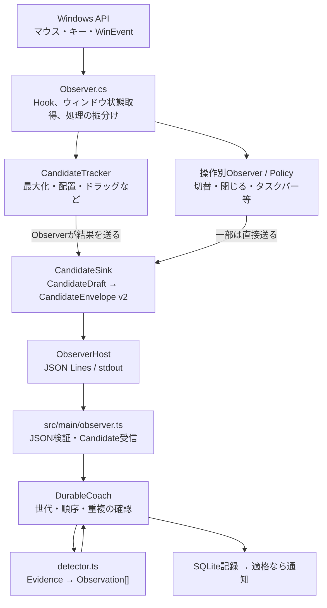

# 現在の検出アーキテクチャ

**これは現行実装の説明**。リファクタリング後の設計ではない。構造は2026-11-06の[コード](https://github.com/YutoMatsui21/shortcut-expert/tree/c1203ec79cf0976a2dad1e65b8c2451fcbe14ef7)で確認した。変更後の実態はコードで再確認する。

## 処理の全体像

**C#からTypeScriptへ送っているのは生のOSイベントではなく、入力と結果を照合したCandidate**。1行につき1つのJSONオブジェクトを標準出力に送る（ディスク上にJSONLファイルを作るわけではない）。

## 各コンポーネントの入力・出力

| 現行コンポーネント            | 入力                                                                                                                       | 出力・役割                                                                                                                     |
| ----------------------------- | -------------------------------------------------------------------------------------------------------------------------- | ------------------------------------------------------------------------------------------------------------------------------ |
| `Observer.cs`                 | `OnMouse`（低レベルマウス）、`OnKey`（低レベルキー）、`OnEvent`（foreground／位置／移動開始・終了／最小化／破棄等）、timer | Win32でウィンドウ状態・押下対象等を読み、各Tracker/Observer/Policyの**具体的なメソッドを順序付きで呼ぶ**。状態キャッシュも保持 |
| `CandidateTracker.cs`         | 入力、押下時のウィンドウ状態、WinEventによる状態変化・経過時間                                                             | `WindowCandidate`／`PlacementResult`／`CompoundMoveResult`。最大化・復元／最小化、配置、ドラッグ・画面移動の候補               |
| `WindowSwitchObserver/Policy` | キー・クリック・foreground・timer                                                                                          | 切替が成立すれば`protocol.Switch`                                                                                              |
| `WindowCloseObserver/Policy`  | 閉じる入力・ウィンドウの存続/DESTROY・timer                                                                                | 閉じる確証があれば`protocol.Close`                                                                                             |
| `TaskbarInputObserver`等      | タスクバークリック／Win+数字・UIA snapshot・非同期確認                                                                     | `protocol.Taskbar`                                                                                                             |
| `InactiveCaptionPolicy`       | 非アクティブウィンドウクリック・foreground・最終ウィンドウ状態                                                             | `Observer`のtimer経由で`protocol.CaptionClick`                                                                                 |
| `CandidateProtocol.cs`        | 上記の各種候補結果                                                                                                         | Evidenceを含むv2 `CandidateEnvelope`、generation・sequence・発行順（`gate`）                                                   |
| `ObserverHost.cs`             | Envelope・制御コマンド                                                                                                     | JSON直列化とstdoutへの書込み（`outputLock`）                                                                                   |
| `src/main/observer.ts`        | helperのstdout行                                                                                                           | `candidateV2`で形式を検証した`ObserverCandidate`                                                                               |
| `src/core/durable-coach.ts`   | 検証済みCandidate                                                                                                          | generation／sequence／transactionの重複を確認し、分類後の原子保存・通知判定                                                    |
| `src/core/detector.ts`        | Candidateと`evidence.kind`                                                                                                 | 0～2件の`Observation`（操作ID、入力由来、案内キー等）                                                                          |

C#側の`WindowCandidate`内部に古い`protocolVersion=1`表記があっても、外部送信前に`CandidateProtocol`が**v2へ変換する**。この内部型と通信形式を混同しない。

## どこで状態を保持しているか

| 状態                                                                    | 現在の所有者                                              |
| ----------------------------------------------------------------------- | --------------------------------------------------------- |
| Hook、ウィンドウ状態のキャッシュ、入力ルーティング・取消順序、50ms poll | `Observer`                                                |
| 入力／ドラッグ／Win+↑・↓の候補、配置シリーズ、transaction採番           | `CandidateTracker`（配置は`PlacementPolicy`も状態を持つ） |
| 背後ウィンドウcaptionのクリック候補                                     | `InactiveCaptionPolicy`                                   |
| 切替・閉じる・タスクバーの候補、専用timer/worker                        | 各専用Observer／Policy                                    |
| generation、送信sequence、Envelopeの発行                                | `CandidateProtocol`                                       |
| stdout書込・helperの起動制御                                            | `ObserverHost`                                            |
| 子プロセス、行バッファ                                                  | `ObserverClient`                                          |
| 再配送排除、記録、通知の適格性                                          | `DurableCoach`                                            |

## 機能追加時に変更が広がりやすい理由

- **Observerが個別実装を知る**：`tracker.Complete/FinishMove`など、操作ごとに呼出し条件・戻り値別のProtocol呼出しがある。
- **Trackerの責務が広い**：最大化・キー系列・ドラッグ・配置が押下/取消状態を共有している。
- **競合処理が分散**：通常切替・背後ウィンドウcaption・ドラッグ・タスクバーは、`Observer`が特定順でCancel/抑制する。
- **候補の出口が複数**：Trackerの戻り値はObserverが送る一方、専用Observerの一部はProtocolを直接呼ぶ。
- **TSの分類が集中**：`classifyGesture`の内部でEvidence種別により分岐する。

ただし、これらが**直ちに不具合であるという意味ではない**。特に既存の競合・取消順序には誤採用防止の理由がある。目的は振る舞いを変えずに変更箇所を局所化すること。

## 現行で注意が必要な操作

- **非アクティブcaptionクリック**：ボタン不明時は通常のドラッグ候補と**並行追跡**でき、`MOVESIZESTART`ではクリック候補を取り消す。単純な先着専有ではない。
- **複合ドラッグ**：画面移動＋最大化／四隅は**1つのCandidateから2つのObservation**を生成し、中間の復元等を別計上しない。
- **Win+数字**：タスクバー候補の経路を優先し、通常切替へ二重計上しない。
- **確証のない案内**：操作の記録と、等価なショートカットの案内は別判定。特にW02は移動が確証済みなら方向不明でも記録し、キー案内を`null`にできる。

操作の具体的な成立条件は[操作別設計](../../operations/README.md)を正本とする。

→ **新しい構成は[目標アーキテクチャ](target.md)**。

## Candidate Sink (Issue #173)

All production candidates pass through `CandidateSink.Submit(CandidateDraft)`. The existing operation adapters construct drafts; only Submit assigns the wire sequence and invokes the output callback under the generation gate. ObserverHost retains its outputLock. Transaction IDs remain input IDs assigned by existing policies; cancellation and duplicate completion prevention remain in those policies, and delivery deduplication remains in DurableCoach.

| Candidate source                                           | Sink adapter         |
| ---------------------------------------------------------- | -------------------- |
| Observer / CandidateTracker: window state and monitor move | Complete             |
| Observer / CandidateTracker: placement and compound drag   | Placement / Compound |
| Observer / InactiveCaptionPolicy                           | CaptionClick         |
| WindowSwitchObserver                                       | Switch               |
| WindowCloseObserver                                        | Close                |
| TaskbarInputObserver                                       | Taskbar              |
| SnapInvocationObserver: non-product validation route       | Invocation           |

`CandidateProtocol.V2` is now a pure legacy evidence converter. WindowCandidate's internal sequence remains for legacy policy fixture compatibility and never controls wire numbering. The independence comparison fixtures also use CandidateSink; direct V2 conversion fixtures do not emit output. The pre-refactor component descriptions above refer to CandidateProtocol; their emission responsibility now belongs to CandidateSink.

The fixture-only `ObserverHost.fixtureCandidate` command deliberately bypasses the sink to inject exact envelopes into TypeScript, preserving parser/replay tests. Control responses and bounded diagnostic aggregates are not candidates and still use Host output directly. No raw input or window identity is added to drafts or JSONL.

## GestureManager（Issue #175）

`Observer`は引き続きWin32の観測・WindowState取得・配送順序・pollを担当する。取得済みsnapshotと観測時刻をTracker経由で`GestureManager`へ渡す。hook内のOS照会は増やしていない。

`GestureManager`は、Trackerの入力・物理press・移動中対象・drag・release・Win+Up候補の共通管理元になった。共通GestureはローカルID、generationとResetごとのrevision、入力源、対象、開始snapshot、物理性・修飾状態、最新foreground、解放時刻、終端snapshotを持つ。snapshotの時刻は同じ単調時計の観測時刻。IDはtransactionと別で、`DetectionSession`の採番やSinkのsequenceを変更しない。完了済み・取消済み・期限切れ・別Gesture・Reset前の参照への完了要求は拒否する。履歴を蓄積せず、現在のGestureと既存Policyが必要とする参照だけを保持し、外部送信・保存しない。

物理pressからMOVESIZESTARTで作るdrag入力は同じGestureを参照し、従来のinputAgeMs用の時刻変換は互換入力にだけ適用する。Win保持中のPlacement系列も同じGestureと開始snapshotを参照し、途中のWin+Up候補を作っても共通IDを作り直さない。入力終了は`awaiting-result`、Policyの終端処理は`completed`または`cancelled`とし、期限の選択は既存Policy側に残す。

### 今回残した責務

- Trackerのroute分類、クリック距離・ダブルクリック・キーrepeat／注入キー、Win+Down継続判定、診断probe、操作固有の期限と成立条件は既存のまま。互換`Input`のroute・transaction・Conflicted等は既存判定のために残し、共通Gestureに操作の成否を格納しない。
- PlacementPolicyの形状系列・heldキー・期限は残し、開始／解放／完了／取消のみ共通寿命へ接続した。
- 背後captionは既存の並行追跡・foreground照合を維持する。W11のDESTROY待ち、W12の非同期UIA、W01/W12排他と各workerの寿命は専用Observer／Policyに残す。それらの入力を共通Gestureへ移す作業は後続のRouter／独立Detector移行で扱う。
- GestureManagerの完了はCandidateの送信ではない。既存PolicyがCandidateを返し、CandidateSinkが世代・送信順を管理する。検出条件、途中計上の抑制、Protocol v2、TS分類、保存・通知は変更していない。

人工入力の共通寿命と本番Trackerへの接続は`GestureTests.cs`、Native出力の互換性は#172の固定baselineと既存Policy試験で検証する。自然入力・実OSのイベント順序・通知表示の受入とは区別する。
