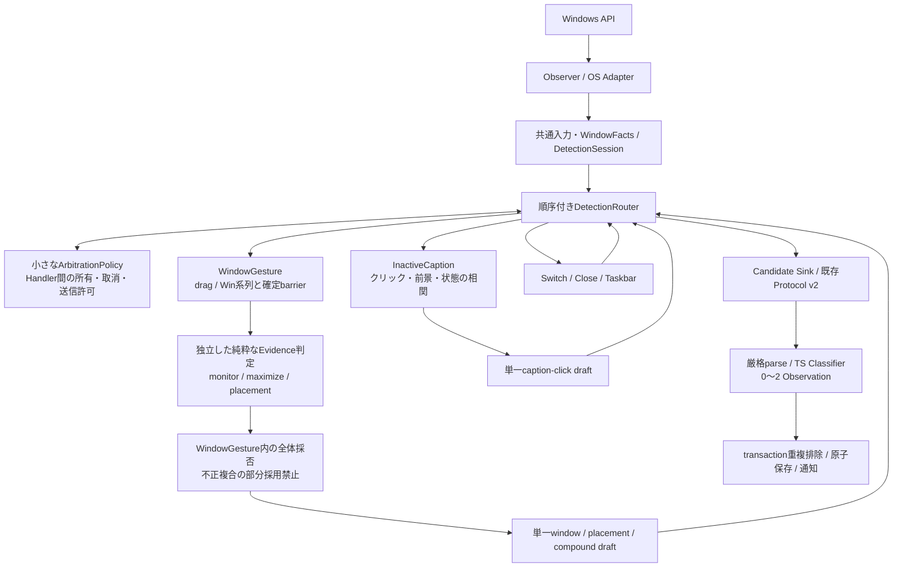

# 独立検出＋結果統合の隔離実験

## 判断と範囲

**操作成立の純粋な判定は独立化できるが、結果の集合だけでは現行動作を維持できない。正式な目標構成を維持し、Handler内部で独立した判定関数を使う案を推奨する。** 調停の名称や配置は変更可能だが、寿命・取消・入力の所有権・複合全体の採用責務はなくならない。

これは採否判断用の実験であり、[正式なtarget](../target.md)と[正式なmigration](../migration.md)は変更していない。正式案は5 Handler、順序付きRouter、ArbitrationPolicy、Sinkであり、操作ID別Detector構成ではない。[既存調査](findings.md)と[理想案](ideal-feasibility-and-proposal.md)の未実証仮説を、限定したfixtureで比較した。

- 基準：main `18c2315`。PR #166は `ab3dd734`、#167は `c07b6f86` でマージ済み。#167の最終branch headは `b199802c714152c5e86cd1a53d481bca1501f53f`。作業開始時のmainは両方を含む。未マージbranchの取り込みは不要。
- 規範：[現行要件](../../../ui-requirements.md)の8操作・複合ドラッグ・非アクティブcaption・プライバシー条件。過去の理想案にある「未実証」の条件を現行要件へ逆輸入しない。
- 本番のObserver、Tracker、Policy、Protocol、TS分類、保存・通知は無変更。実験は `validation/independence/IndependentDetection.cs`、呼出しは既存native policyテストプロジェクトのみ。実helperにはリンクされない。
- 自動試験は合成入力・固定カテゴリ・隔離SQLiteだけ。Windows APIを呼ぶObserver、自然入力精度、実通知表示、混在DPIの実OS順序は今回未検証。#166の物理Shadow結果を今回のアーキテクチャの実機合格とは扱わない。

## 固定した比較基準

基準の期待値を試作の結果から作っていない。以下の既存本番テストと要件を参照し、試作と本番へ同じfixtureを渡す。期待操作IDはテーブルに独立して記述し、C#候補をMainの厳格parse→本番 `classifyGesture` に通して照合する。

| 基準テスト                                             | 再利用する契約                                                                             |
| ------------------------------------------------------ | ------------------------------------------------------------------------------------------ |
| `tests/native/policy/MouseRepositionTests.cs`          | #167の最大化維持W02、配置済み再配置、process/layout/解放/期限/foreground/取消負例          |
| `CompoundDragTests.cs`                                 | 上端解放許容範囲、不正複合でW02へのfallback禁止、単一複合出力                              |
| `PlacementTests.cs`                                    | 本番PlacementGeometry、1px幾何、直接端解放、Win保持の中間half保留と最終quarter             |
| `InactiveCaptionTests.cs`                              | 物理入力・neutral/対象適格性、4px/500ms、process/対象、fallback、前景、750ms失効、単一確定 |
| `Program.CheckWinDownGrouping`                         | 先行W04の即時計上と後続Win+↓抑制（今回変更しない）                                         |
| `WindowSwitchTests.cs` / `TaskbarTests.cs`             | 通常W01の対象条件、W12 slot/UIA契約、入力取消                                              |
| `tests/native/native-operation-policy.test.ts`         | 本番C#→v2厳格parse→Core分類→隔離SQLite、通知前保存・再配送                                 |
| `tests/operations/cross-monitor-compound-drag.test.ts` | 不正Evidence全体棄却、二件目書込失敗の全rollback、通知1件、再配送非重複                    |
| `tests/operations/inactive-caption-click.test.ts`      | captionの0〜2分類、部分成立、原子保存・rollback・通知・再配送                              |

### 実験Aの入力列

固定target=11/process=7、2画面の固定構成・work/DPI/左右関係。press=0ms、MOVESIZESTART=100ms、物理解放後、MOVESIZEEND=5000ms。**1000ms制限はpress→STARTであり、ドラッグ時間全体ではない**。本番には既存通りENDからの別期限を追加しない。

中間の `Complete` に復元状態を渡しても発行0。ENDで0〜1 Candidate、二度目のENDで0。単独・同時の生の操作提案と、全体採否を適用した最終Candidateは別に比較する。

| 開始→終端 / 負例                                             | 最小統合のみ  | 全体採否付き / 本番          |
| ------------------------------------------------------------ | ------------- | ---------------------------- |
| 最大化A→最大化B                                              | W02           | W02                          |
| 通常A→最大化B                                                | W02＋W03      | W02＋W03                     |
| 通常A→最大化A                                                | W03           | W03                          |
| 通常A→Bの四隅                                                | W02＋W07      | W02＋W07                     |
| 通常A→通常A / 同monitor同quarter                             | なし          | なし                         |
| 通常A→最大化B、上端から80pxで解放                            | **W02が残る** | 全体棄却                     |
| 通常A→四隅B、側端から80pxで解放                              | **W02が残る** | 全体棄却                     |
| 通常A→Bのhalf                                                | **W02が残る** | 全体棄却（W02＋W06は対象外） |
| 未解放、取消、injected、START=1001ms                         | なし          | なし                         |
| foreground不一致、process/layout変更、解放monitor/work不一致 | なし          | なし                         |

計18列。最大化A→最大化BをW03にせず、ドラッグ中の一時復元をW04にしない。W07は本番 `PlacementGeometry.Drag` を直接再利用。W02は安定構成・同一process・monitor差・解放等の事実を評価し、W03は開始normal・終端max・arranged既知・上端解放等を評価する。W02/W03の試作述語はTrackerの該当条件から抽出した実験用再記述で、全経路の置換ではない。

### 実験Bの入力列

press=0ms/inputTick=100、通常foreground eventTick=110、解放100ms、状態確認150ms、最小化後の別foreground=160、Poll=510ms。499msでは発行0、500〜750msで最大1、751msで失効、再Pollで発行0。入力の時計とWinEvent tickを混同しない。

| ケース                                                               | 本番・試作の最終操作ID                     |
| -------------------------------------------------------------------- | ------------------------------------------ |
| 非active最大化 / 最小化＋一時前面化                                  | W01＋W03 / W01＋W04                        |
| 状態不変で前面化のみ                                                 | W01                                        |
| 前面化なしの既知最大化 / 最小化ボタン                                | W03 / W04                                  |
| hit=1/0/-1のfallback＋前面化＋最大化/最小化                          | W01＋W03/W04                               |
| fallback＋前面化なし                                                 | なし（既知ボタンの状態単独成立とは異なる） |
| fallback本文・状態不変 / 最大化起点の復元                            | W01（復元W04を勝手に追加しない）           |
| 最大化起点の最小化ボタン                                             | W01＋W04                                   |
| 最大化起点の最大化ボタン                                             | なし（復元経路として転用しない）           |
| 移動4px / 5px                                                        | W01＋W03 / なし                            |
| 解放500ms / 501ms                                                    | W01＋W03 / なし                            |
| Poll=500 / 750 / 751ms                                               | W01＋W03 / W01＋W03 / なし                 |
| 古いforeground tick=99                                               | W03のみ                                    |
| 最小化確認後の別foreground / 確認前の別foreground                    | W01＋W04 / なし                            |
| 最大化後の別foreground                                               | なし                                       |
| MOVESIZESTARTへ移行 / 取消                                           | なし                                       |
| 対象・解放process・結果process不一致、修飾、injected、不適格、未解放 | なし                                       |

計31列。共通入力の適格性を勝手に緩和しない。`Eligible` はObserverで確証済みのneutral、前景/対象Read、process照合を表す境界値であり、試作でWin32 style照会を置き換えたものではない。この境界自体の細目は既存 `InactiveCaptionTests.EligiblePress` とstyle安全性テストを再利用する。captionなし対象を許す専用経路と、通常W01のcaption必須経路を一本化しない。

## 3段階比較と結果

1. **単独**：各関数の引数はimmutableなDragまたはClickだけ。他Detector、結果一覧、可変pendingへの参照を持たない。対象関数を単独で呼び、同時実行時の当該提案と一致させる。
2. **同時**：同じsnapshotを3関数へ渡す。逆順の評価でも同じ集合になる。ここでの同時は同期fan-outであり、並列threadの安全性や実Observer配送を意味しない。
3. **統合**：本番Tracker/InactiveCaptionPolicyへ同じ列を渡し、本番CandidateProtocolで1 Envelopeへ変換。実験版も既存Protocolを使う。候補数（nullまたは1）、全Envelopeフィールド（route、transaction、Evidence、sequenceを含む）、確定/再発行を照合。49列で一致。

最小Composer（同gesture集合化・ID重複排除・許可組合せ・v2変換）**だけ**ではAの3列が不一致。独立W02の入力・monitor移動自体は正しくても、終端不正による全体棄却の情報が結果集合から失われる。W02という集合は「正常な単独移動」と「失敗した複合の残り」で同一であるため、**操作集合のallowlistだけでは区別できない**。

対照版では `Admit` に終端show/arrangedと全体採用条件を与えた。これは結果整形ではなく**意味的な調停**である。巨大Composerへ隠さず、実験でも `Bundle` と分離した。失敗したterminalをW02の関数内で参照しても独立性の問題は移動するだけで、同じ条件の重複実装になる。

Bでは3関数が互いを参照しなくても一致する。ただし `ClickLive` は「適格な最小化を観測した後だけ、別foregroundへの移行を許す」という**意味を持つ取消条件**を含む。これを共通Gestureへ移すと、そのGestureは汎用入力管理だけではなくcaption契約も持つ。純粋な入力管理＋単純Composerだけで調停が消えたという証拠にはならない。

採用された全実験出力は既存native TSテスト内でMain厳格parse→Coreの最終操作ID→実SQLite→通知要求まで通した。各gestureでrevision増分1、0〜2操作の保存、通知要求1、sequenceを変えた同transaction再配送で保存/通知不変を確認。null列は本番も実験も発行0。書込故障時の二件原子性は上記既存テストを再実行する。本番のCandidate/Observationの意味・保存方式は変更していない。

## 必要な共通情報と残す責務

| 管理する情報                                                        | 理由 / 所有範囲                                                                                        |
| ------------------------------------------------------------------- | ------------------------------------------------------------------------------------------------------ |
| generation＋入力ID＋対象ID（processを含む同一性）                   | 時刻近接だけで別gestureを合成しない。実験は異なるinput/target/generationの結果を混入させても結合しない |
| 物理性・修飾/競合・押下/解放・neutral                               | 誤採用防止。OS入力補助と対象適格性を保持                                                               |
| 開始snapshot、START時刻差、解放monitor/work/座標、ENDの最終snapshot | 操作別に期限が異なる。開始/終端/途中を区別し、状態差だけで原因を推測しない                             |
| click→drag、Win保持方向列などの入力系列種別                         | 派生W04・途中W06を先に発行しない。クリック専有とfallbackの並行追跡を区別                               |
| foreground/状態イベントの順序と確認済み事実                         | 最小化前後で取消が異なる。単一のafter/最終foregroundでは情報不足                                       |
| open/closed/cancelled/published                                     | 遅延結果の確定barrier、at-most-once、取消後の再発行禁止                                                |
| 世代とworkerの復帰先thread                                          | Stop/Reset後の古い結果を無効化。message-loop上で世代再検査し、Protocol gateを維持                      |

試作 `GestureLifetime` はopenではTake不可、close後一度だけ、cancel後・reset旧世代はTake不可を確認する小さな寿命gate。実験出力は同期fan-out完了後に統合する。任意の非同期workerからの部分結果を期限まで待つSchedulerは実装していない。実装時は「全Detectorが完了したのか／まだ結果待ちか／棄却なのか」を区別する必要があり、単なる結果なしを完了と扱えない。

## その他の操作との関係

| 検証項目          | 独立検出可能か                                   | 統合可能か                         | 調停が必要か                                           | 課題                                                                                   |
| ----------------- | ------------------------------------------------ | ---------------------------------- | ------------------------------------------------------ | -------------------------------------------------------------------------------------- |
| W02＋W03/W07      | 49列中A18列で成立述語の独立性を確認              | 全体採否付きで本番と一致           | **必要**：不正複合全体棄却、終端まで保留               | 単純統合3反例。実Observerの全境界・実入力は未検証                                      |
| W01＋W03/W04      | B31列で独立性を確認。ただし共通caption契約が必要 | 1 caption-clickへ一致              | **必要な取消責務が残る**：drag譲渡、前景/最小化順序    | 汎用Gestureへcaption意味を押し込むと共通層が肥大化                                     |
| W01とW12の排他    | 設計上は入力sourceの排他的分類で可能             | 既存単独Evidenceを維持できる見込み | source確定・予約は必要。W12失敗でもW01へfallbackしない | 今回独立Detector未実装。UIA不明/遅延をW01許可と扱わない                                |
| W06/W07の連続操作 | 同じWin保持列の最終shapeを独立評価できる見込み   | Win解放/結果確定barrier後なら可能  | 系列所有・中間候補抑止が必要                           | 今回独立Detector未実装。既存Placementテストを再利用。途中W06を先送信すると取り消せない |

W01/W12は本番 `WindowSwitchObserver.Read` のタスクバー等対象除外とTaskbarの専用入力/UIA照合により現在分離する。新構成ではUIA成功という「W12結果」ではなく、入力開始時のsourceをW01にも渡す。判明待ちは保留または保守的棄却とし、失敗時W01へfallbackしない。これは設計上の見込みであり、新Routerでの実行証拠ではない。

ドラッグ中W04は入力系列をdragとして識別し、W04固有の適格入力がないことを各判定へ渡すことで抑止可能。今回、本番 `Complete` の中間復元発行0は確認したが、独立W04の全経路を作ったわけではない。W04のWin+↓連続の先行確定時刻も今回の実験では変更していない。

対象変更・入力取消・結果遅延はGestureの寿命と操作固有pendingを両方維持する。全操作を共通500msで打ち切る等の単純化は不可。Stop/Resetは実験寿命gateと本番Protocolの旧世代出力0を確認したが、実hook停止とworker競合の検証ではない。

## 6つの結論と推奨案

1. **各操作の述語は独立化可能**。確認済み範囲はA/Bの49fixture。各操作のOS相関・pendingを完全独立なHandlerにする安全性まで証明していない。
2. **Gesture管理は必要**。入力ID・対象・世代、開始/終端snapshot、解放とEND、source/系列、取消・確定状態を持つ。caption固有の状態相関はInactiveCaption内へ残す方が小さい。
3. **Routerの単純broadcastだけでは不十分**。純粋述語への配送は単純でよいが、callback/非同期復帰の順序、caption→drag譲渡、W12 source、resetを扱う調停境界が別途必要。今回その本番Routerは作っていない。
4. **Composerの単純統合だけでは不十分**。同じW02結果でも不正複合の残余を棄却する必要がある。全体採否はHandlerか明示的な小さなAdmissionへ置く。Composerは承認済みdraftの1候補化だけに限定する。
5. **調停責務は不要にできない**。別クラス名 `ArbitrationPolicy` が不可欠という意味ではない。残す責務は入力系列の所有・移譲、競合取消、確定barrier、複合全体採否、旧世代/遅延結果の送信許可。Gesture/Detector/Composerへ分散して名前だけ消す案は推奨しない。
6. **正式targetを基本に採用することを推奨**。WindowGestureとInactiveCaptionが複合候補を所有し、内部の純粋判定を独立させる。Router/ArbitrationはHandler間だけ、複合全体採否は所有Handler内へ置けば、巨大な全操作組合せ表を避けられる。操作ID決定は引き続きTS。実験のW ID付きPartは検証専用で、本番C#のwireへW IDを追加する提案ではない。



共通FACTは全ての操作固有状態を所有する巨大GestureManagerではない。各Handlerの固有pending/期限を残す。最小Composerは上図のHandler内でEvidenceを組み立てる実装詳細にでき、全Handlerの結果を待つ独立の巨大サービスは不要。

## 段階的移行の提案（未実施）

1. 今回の比較fixtureと既存回帰群を固定し、Observer配送/Stop/worker寿命の不足ケースを追加する。操作IDだけでなくv2候補数・route・確定タイミング・取消を比較可能にする。
2. 正式migration通り、出力Sinkと世代/transaction採番を統一する。JSONLとTS/原子保存の意味は変えない。
3. WindowGestureとInactiveCaptionの境界を作る。まず互換配送順で本番policyをそのまま包み、候補所有者を一つにする。
4. WindowGesture内部で事実snapshotと純粋述語を抽出する。今回の実験述語をそのまま製品へコピーせず、既存全入力経路・geometry/期限/取消に対して差分試験を先行する。全体棄却は所有Handlerの明示的採否関数に残す。
5. Routerと小さなHandler間調停へ順序・cancel/skip・送信許可を移す。taskbar source、caption既知/unknownの所有権差、drag譲渡、worker復帰と世代を本番fixtureで検証する。
6. TS ClassifierをEvidence別に分割しても既存入口を保つ。最終同buildで本人同意の隔離物理受入を実施する。精度・実OS順序が未確認のまま8独立Handlerへ広げない。

正式target/migrationの書換えはこの判断への合意後の別変更とする。今回のPRは実験・テスト・調査のみで、merge・公開・配布は含めない。

## 再実行と証拠

```powershell
node scripts/test/test.mjs native --file=native/native-operation-policy.test.ts
npm.cmd run test:unit -- --test-concurrency=2
npm.cmd run test:native -- --test-concurrency=2
npm.cmd run typecheck
```

実験データは既存policy実行レポートの `independence` に含まれる。入力座標・ID等は合成fixtureのメモリ内だけで、製品への観測追加や実入力ログ保存を行わない。レポートには固定case名、独立提案、基準/試作Candidate、固定期待IDと確定時点を出す。全Candidate内容の同値性はC# record比較とTS deepEqualの両方で検証する。

検証実行結果・専用レビュー・PR headのCIはPR本文に記録する。実機未検証と設計上の見込みは上記の通り残す。
