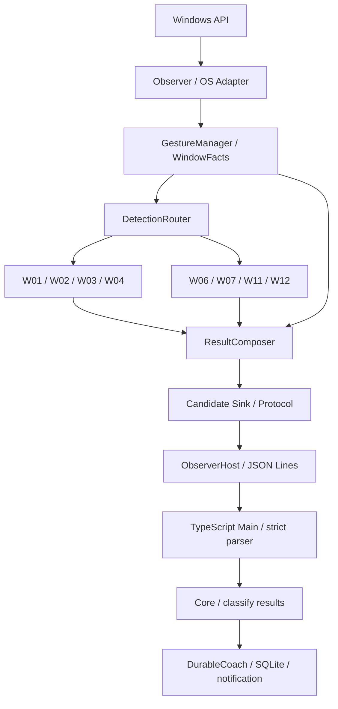

# 目標アーキテクチャ

**状態：採用する目標構成。共通基盤は段階導入中、独立結果の本番切替は未実施。** 現行コードは[現行構成](current.md)、実装順序は[移行計画](migration.md)を参照する。

## 目的と基本方針

Windows上の一連の入力から各操作の成立を**独立に判定**できるようにする。新しい操作を追加するとき、既存検出器やObserverの変更を原則不要にする。

- まずシンプルな「共通Gesture管理 → 各操作の独立判定 → 結果統合」を採用する。
- 各検出器は、他の検出器の内部状態・成立結果を参照しない。
- 共有するのは入力の由来、対象、時系列、開始・終了状態、取消・確定などの観測事実。
- 操作ごとの検出条件は個別に修正できるようにする。現行の判定結果を無条件に再現することを目的にしない。
- **独立したArbitrationPolicyは最初から設けない。** 実装・実機検証で具体的な競合を確認した場合のみ、最小限の調整を追加する。

## 全体構成

この図のW番号は**独立した判定責務**を表す。必ずしも各W番号につき1クラス・1ファイルを作るわけではない。マウスとキーの判定を共通化できるかも操作ごとに決める。

## 責務の分担

### Observer / OS Adapter

- Win32のhook・WinEvent・必要なUIA照会を担当し、観測イベントを生成する。
- 押下時と結果確定時のWindowFactsを区別する。
- 個別操作の成立判定や、別検出器の直接呼び出しはしない。
- hook内に重い照会を追加せず、非同期結果は世代と対象を検証して戻す。

### GestureManager

「ウィンドウの形状」ではなく**物理入力系列のライフサイクル**を管理する。

- ジェスチャID、generation、対象ウィンドウ・process、入力源（タスクバー／caption／本文など）、物理性・修飾キー・競合を保持する。
- 入力前snapshot、解放、MOVESIZESTART/END、終端snapshot、foregroundの時系列を関連付ける。
- `observing → awaiting-result → completed / cancelled / expired` のように、取消と最終確定を管理する。実際の状態名は実装時に調整可能。
- Win保持中の方向キー列、ドラッグ中の一時復元・中間配置は**同じジェスチャの途中状態**として扱い、途中結果を外部送信しない。
- 重複確定やStop/Reset後の旧世代の送信を防ぐ。
- W11のDESTROY確認やW12のUIA確認など、操作固有の保留・期限は各検出器の内部に残せる。全操作を単一のタイムアウトへ統一しない。

**共通Gesture情報には、操作固有の成功・失敗を格納しない。** W03が不成立であることを理由にW02を自動的に取り消さない。

### DetectionRouter

- イベントを、必要な入力種別を購読する検出器へ配送する。
- 登録・配送・完了通知だけを担当し、操作の成立や優先順位を判断しない。
- 通常はイベントの同期配送を基本とし、非同期照会が必要な検出器の完了状態も追跡する。
- 検出器同士の直接呼出し、相互Cancel、先着勝ちの専有制御を設けない。

### 独立した操作検出器

検出器は自身の操作について、共通Gesture情報と必要なOS事実から**成立／不成立／判定待ち**を返す。

初回対象はW01（切替）、W02（別画面移動）、W03（最大化）、W04（復元・最小化）、W06（左右半分）、W07（四隅）、W11（閉じる）、W12（タスクバー）。

- W02は入力と始終monitor差を判定する。W03/W07の成功を前提にしない。
- W03/W04は対応する入力と窓状態変化を判定する。別操作の採否を参照しない。
- W06/W07はジェスチャ**最終形状**を判定し、同じ入力列の中間配置を採用しない。
- W01は入力源を確認する。タスクバー操作や閉じる操作に伴うforeground変化を、結果だけからW01と推定しない。
- W11は閉じる入力と対象窓のDESTROY／消滅の確認を要する。
- W12はタスクバー入力とUIA slotの照合を要する。不成立でもW01へのフォールバックをしない。
- 非アクティブ窓のボタン操作は、共有された入力・foreground・状態変化の証拠をW01とW03/W04が各自で評価する。

**独立性は「他検出器の結果に依存しない」という意味。** OS観測やGestureManagerの共通情報を利用することは許容する。

### ResultComposer

同じジェスチャで**確定した検出結果**を束ね、共通の出力単位に変換する。

- ジェスチャID・generation・対象を照合し、別の入力の結果を混ぜない。
- すべての購読検出器が完了したか、操作固有の期限・取消が確定してから結果を発行する。
- 同じ操作の重複を排除し、1ジェスチャの出力を一度だけ確定する。
- W02が成立しW03が不成立なら、**W02のみ採用**する。現行の「不正な複合Evidenceは全体棄却」は新目標では引き継がない。
- 入力・対象・世代・終端の**共通証拠が不正**な場合は、関連する結果を採用しない。
- 特定の操作組合せを先験的に禁じる大規模なallowlistや、全検出器の相互依存をここに作らない。

[Issue #177の確定契約](result-envelope.md)により、成立した既存操作は組合せ・2件上限で棄却しない。W02＋W06、3件以上、部分採用を対象とする。Detector自身の入力・終端証明は維持する。

## 通信・TypeScriptとの境界

現行の外部Protocol v2は、任意の独立検出結果リストを表現できない。**独立検出への移行には通信契約の設計・実装が必要**であり、既存`compound-drag`等のEvidenceを単純に流用しただけでは完了しない。

- C#からは**同一ジェスチャにつき原則1つのEnvelope**を送り、複数の確定結果を同一出力単位にまとめる。
- Envelopeのgeneration・sequence・transaction・再配送防止の意味を維持する。
- 既存v2に新しいEvidence variantを追加する案を第一候補とする。破壊的変更が必要ならプロトコルバージョンを更新する。どちらも型・厳格parser・Core分類・テストを同時に更新する。
- C#が製品上のW IDを断定するのではなく、検証済みの操作別EvidenceをTypeScriptが分類する責務を維持する。
- DurableCoachでは**同一ジェスチャの0件以上の操作を原子的に保存**する。件数制限を置かず全件保存し、適格操作への通知は最大1要求。3件以上の表示は[確定契約](result-envelope.md)に従う。
- ACK喪失後の再配送、保存失敗時rollback、通知の学習状態・入力由来・キー同等性判定を維持する。

既存の複合操作について**一部だけ成立した結果も記録できる**点は意図的な仕様変更。単なるリファクタリングとして既存テストの期待値を黙って書き換えず、新仕様を検証したうえで明示的に更新する。

## 安全性と検証の原則

- 「検出しなかった」場合と「まだ結果待ち」を区別する。期限切れ・対象不一致・旧世代・未解放・非物理入力を成功と推測しない。
- 誤検出や検出漏れが判明したら、まず対象の独立検出器の入力・状態・確定条件を修正する。**必要性が実証されるまでArbitrationPolicyを追加しない。**
- 入力源の区別や途中状態の抑制は、まずGestureManagerと各検出器自身の条件で解決する。
- 移行時は、独立判定→統合→通信→保存・通知まで回帰する。従来と結果が変わるケースは「意図した仕様変更」と「意図しない回帰」を区別する。
- 生のキー列・タイトル・HWND/PID・URL・clipboard・カーソル軌跡は通信・保存しない。必要なモニター幾何は限定して保持する。
- 合成入力・CI成功と、Windows実機での入力・OS通知の確認を区別する。

## 根拠と未確定事項

[PR #169の独立検出実験](independence/composition-experiment-20261107.md)では、W02/W03/W07・W01/W03/W04の成立述語を独立評価できた。ただし、旧複合の全体棄却を再現するには追加の採否処理が必要だった。**旧仕様の完全再現を目標から外す**ことで、単純な結果統合を第一案とする。

- 全8操作の新Router・GestureManager・ResultComposer実装と実機検証は未実施。
- W01/W12の入力源分離、W06/W07のWin保持列、非アクティブcaptionとドラッグの競合、非同期workerの結果確定は、移行中に検証する。
- 通信Evidenceの型・組合せ非制限・原子保存・通知は[確定契約](result-envelope.md)を採用。契約テストと本番実装は #178・#179以降。

**現在の本番仕様を説明する文書ではない。** 本番への切替は[移行計画](migration.md)に従い、段階ごとに行う。
