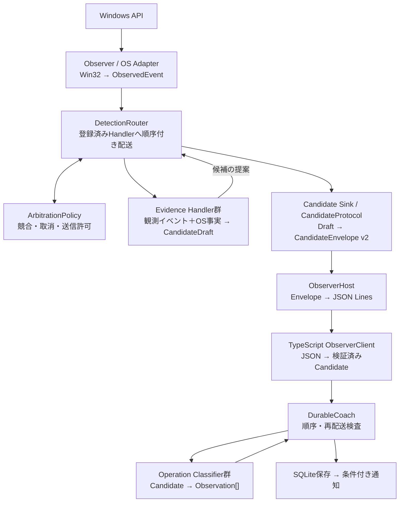

# 目標アーキテクチャ

**これはリファクタリング後に実現する設計**。現在のコードの説明は[現行構成](current.md)。採用条件・記録・通知の意味は変えない。

## 目的と構成

**新しい操作を追加しても、Observerや既存の操作別検出器を原則変更しない**。共通化するのはイベント配信・候補送信・ID発行などの境界であり、操作固有の状態機械を無理に統合しない。



### 入出力・責務

| 要素 | 入力 → 出力 | 責務 |
| --- | --- | --- |
| **Observer / OS Adapter**（C#） | Win32 callback・必要な照会 → `ObservedEvent` | HookとWindowFacts、押下時/結果時のsnapshot。**個別Handlerを直呼びしない** |
| **DetectionRouter**（C#） | `ObservedEvent` → Handler呼出しと候補提案 | 登録、順序、調停の適用。**操作成立を判定しない** |
| **ArbitrationPolicy**（C#） | イベント＋Handlerの公開状態 → 配信・取消・送信可否 | 複数Handler間の競合、専有、複合の所有権を集中管理 |
| **Evidence Handler**（C#） | 観測イベント＋必要なWindowFacts → `CandidateDraft`（またはなし） | OS入力と結果の関連付け・期限・操作固有のpending状態。**W IDは決めない** |
| **Candidate Sink / Protocol**（C#） | `CandidateDraft` → v2 `CandidateEnvelope` | 共通のgeneration/sequence・送信順。stdoutの直列化はしない |
| **ObserverHost**（C#） | Envelope → JSON Lines/stdout | JSON直列化、stdoutの書込排他、プロセス制御 |
| **Parser**（TypeScript Main） | JSON Lines → 検証済みCandidate | v2型・必須項目・世代の検証 |
| **Classifier**（TypeScript Core） | Candidate → `Observation[]` | 製品上の操作ID・採否・案内ショートカット。Win32に依存しない |
| **DurableCoach**（TypeScript Core） | Candidate/Observation → 記録・通知 | transaction重複排除、0〜2件の原子保存、保存後通知の適格性判断 |

## 5つのEvidence Handler

| Handler | 現在の処理をまとめる単位 | 最終候補 |
| --- | --- | --- |
| **WindowGesture** | `CandidateTracker`＋配置Policy：最大化、復元/最小化、半分・四隅、ドラッグ、画面移動 | `window` / `placement` / `compound-drag` |
| **InactiveCaption** | 非アクティブ窓の最大化・最小化ボタン／ボタン不明fallback | `caption-click` |
| **WindowSwitch** | クリック切替、Alt+Tabの確定 | `window-switch` |
| **WindowClose** | 閉じるボタン、Alt+F4とDESTROY確認 | `window-close` |
| **Taskbar** | タスクバー・Win+数字とslot照合 | `taskbar-input` |

**WindowGestureを最初からさらに3つの独立Handlerへ分割しない**。共有する押下・ドラッグ・取消状態をその内部に閉じ込める。内部Policyの整理は可能。初回対象外のSnap Invocationは登録しない。

## インターフェースの契約

以下は**概念上のC#型**。型名やenum名は調整してよいが、責務と入出力は維持する。

```csharp
interface IEvidenceHandler
{
    string Id { get; }
    EventInterest Interests { get; }
    HandlerStatus Status { get; }            // 読み取り専用の最小状態
    HandlerResult Handle(ObservedEvent e, IDetectionContext context);
    void Cancel(CancelReason reason);
    void Reset(int generation);
}

record HandlerResult(ClaimTransition Claim, IReadOnlyList<CandidateDraft> Proposals);

interface IArbitrationPolicy
{
    DispatchPlan Plan(ObservedEvent e, DispatchPhase phase,
        IReadOnlyDictionary<string, HandlerStatus> statuses);
    bool AllowPublish(string handlerId, CandidateDraft draft,
        IReadOnlyDictionary<string, HandlerStatus> statuses);
}

interface IDetectionContext
{
    IWindowFacts WindowFacts { get; }
    ITransactionIds Transactions { get; }
    int Generation { get; }
    long NowMs { get; }
}

interface ICandidateSink
{
    void Publish(CandidateDraft draft);
}
```

**データの境界**：

- `ObservedEvent`：C#内部のみ。入力種別、時刻、対象、必要な入力フラグ、時点付きsnapshot/照会手段を持つ。生イベントをJSONLへ渡さない。
- `CandidateDraft`：HandlerからRouterに渡す内部候補。**既存C#の`Evidence`派生型を再利用**し、transaction/date/origin/route/injected/conflicted等を持つ。Routerで承認されるまで送信しない。
- `CandidateEnvelope`：通信専用の**既存protocol v2**（generation/sequence/transaction/evidence等）。当面スキーマ・意味とも変更しない。
- `Observation[]`：TSが製品の操作IDと案内キーへ変換した結果。複合候補から2件返せる。

**Dispatcher（Router）とinterfaceは別物**。interfaceはHandlerの受け取り方、Routerは実際の配送役。Handlerは`CandidateProtocol`や`Console.WriteLine`を直接呼ばない。

## 配送・調停のルール

**単純な全件broadcastも、「最初に候補を作ったHandlerが必ず独占」も禁止**。Routerは**同じ観測スレッドで同期・順序付きに**動き、Policyがイベントごとに配送と取消を判断する。

1. `Plan(event, phase, statuses)`で次に実行する**Deliver / Cancel / Skip**を決める。
2. 1アクション実行して`HandlerResult`と`HandlerStatus`を更新し、**次のphaseの計画を再評価**する。最初の計画を最後まで使い回さない。
3. Handlerの最終提案に対して`AllowPublish`を確認し、許可されたものだけSinkへ送る。別Handlerの候補が同じジェスチャを重複確定しない。
4. **特別な競合がない**独立Handlerは購読イベントを受け取れる。登録は`DetectionComposition`の1か所に集約。競合がある新操作だけPolicyへ交差ルールを追加する。

Handlerの状態ビューは、例えば「候補なし／並行追跡中／専有中／確定」と、開始・解除・譲渡・確定の変化を表す。これは**transactionと別**。候補を先行採番して取消した結果の番号欠番は許容する。

### 維持する特殊な優先順位

| イベント・競合 | 変えてはいけない扱い |
| --- | --- |
| **非アクティブcaption** | ボタン既知なら専用候補が通常切替・状態変更を抑制。**ボタン不明fallbackはWindowGestureのドラッグ追跡と並行可能**。MOVESIZESTARTではcaptionを取消・dragへ譲る |
| **通常マウス入力** | Trackerの入力補助 → Taskbar → WindowSwitch → WindowClose → WindowGestureの解放/移動。左押下は対象確認後、caption専用経路が成立すれば切替/閉じるを取消 |
| **キー入力** | captionと不明マウス候補を取消 → Taskbar → WindowSwitch → WindowClose → WindowGesture。**Win+数字はTaskbar専属** |
| **foreground/WinEvent** | caption・closeの保留を先に整合 → WindowGestureの前景/窓状態 → WindowSwitchの確認など、既存の早期return・取消順序を維持 |
| **MOVESIZESTART/END** | startでcaption取消・switch取消、WindowGestureがドラッグを所有。endで最終結果をまとめ**1Candidate**を提案し、派生復元や途中配置を別計上しない |
| **timer・非同期結果** | 既存の個別timer/worker・検出期限を維持。結果は**元のmessage-loop thread**でRouterへ返し、generationを再確認。専用timerは対象Handlerへだけ配送 |
| **Stop/再起動/表示変更** | 既存のCancel範囲・Reset順・旧世代無効化を維持。例外時は誤採用せずfail closed。無関係なpendingまで無差別に消さない |

**複合候補の発行者は1つ**：非アクティブcaptionのW01＋W03/W04はInactiveCaption、画面移動＋最大化/四隅のW02＋W03/W07はWindowGestureが最終候補を作る。**同じtransactionで2個のCandidateを送り、TypeScriptで合成する方式は採らない**。

## 状態の所有者とOS依存

- **WindowFacts**：`Observer.states`とWin32読取の境界。クリック時のbeforeと結果時のafterを区別し、必要時のみ照会。全マウス移動で全面snapshotを作らない。
- **各Handler**：個別pending、time window、独自timer/worker。各Policyの確証条件・timeoutを一本化しない。
- **DetectionSession**：generationと**全経路のtransaction採番**。`NextTransaction()`だけでなく`CandidateTracker`内の直接`++transaction`も移す。候補取消による欠番可。
- **CandidateProtocol**：v2 Envelopeのgeneration/sequence/発行順の`gate`。
- **ObserverHost**：`outputLock`によるstdout書込排他（Protocolの`gate`とは別）。
- **TS Core**：操作の採用・ショートカット同等性・再配送防止・記録・通知。

生の文字、キー列、ウィンドウタイトル、HWND/PID、URL、ファイル名、clipboard、生カーソル軌跡などを**通信・保存しない**。ただし既存Evidenceのモニター境界（x/y/width/height）は必要な表示幾何なので維持する。TSのparserは未知のfieldを捨てる場合があるため、**生JSONLもプライバシー検査する**。

## TypeScript側の分割

`src/core/detector.ts`の`classifyGesture`を互換入口として残し、`evidence.kind`ごとの分類関数を独立させる。複合の1Candidate→2Observationを維持し、`DurableCoach`の永続化契約は変えない。**操作IDごとに1Handler/1ファイルへ分割する必要はない**。

→ **作業順序は[移行計画](migration.md)、変更前後の保証は[回帰テスト](verification.md)**。
